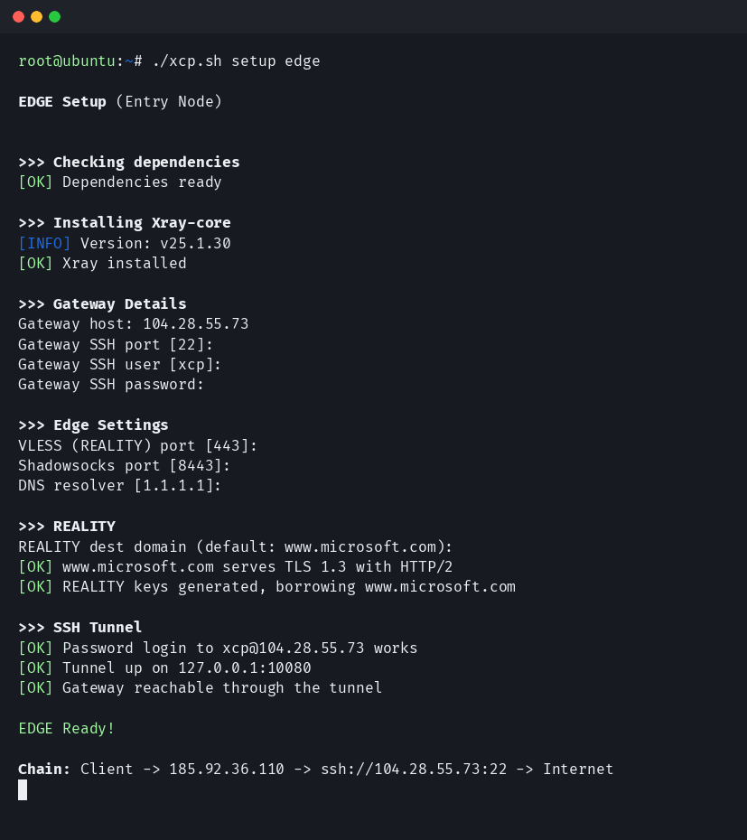

# Xray Chain Proxy

One-command chain proxy for bypassing internet censorship, built on [Xray-core](https://github.com/XTLS/Xray-core).




---

## Why Xray Chain Proxy?

Restricted networks block many websites. This tool creates an encrypted two-hop chain that is fast, reliable, and easy to replace if blocked.

```
┌────────┐      ┌────────┐   SSH tunnel   ┌─────────┐      ┌──────────┐
│ Client │ ──── │  EDGE  │ ═════════════► │ GATEWAY │ ──── │ Internet │
│ (You)  │      │(Entry) │                │  (Exit) │      │          │
└────────┘      └────────┘                └─────────┘      └──────────┘
```

| Server    | Location            | Role                              |
| --------- | ------------------- | --------------------------------- |
| `EDGE`    | Restricted region   | Entry point, low latency to you   |
| `GATEWAY` | Unrestricted region | Exit point, fetches from internet |

- **EDGE** is close to you = low latency
- **GATEWAY** has free internet = unrestricted access
- The link between servers is a **persistent SSH tunnel**, riding on the `sshd` every server already runs
- If EDGE gets blocked, just spin up a new one

## Features

- **2 client protocols** — VLESS+REALITY (443) and Shadowsocks (8443), both authenticating without a cleartext credential
- **REALITY camouflage** — borrows a real site's TLS handshake, so probes on 443 get a genuine answer
- **SSH chain link** — EDGE logs in to GATEWAY with a password and forwards a port
- **Dedicated tunnel user** — GATEWAY creates a shell-less `xcp` user for the link
- **Link health checks** — the tunnel is fetched through every 60s, and restarted when it stops carrying traffic
- **DNS built in** — Loopback port 53 on both servers, resolver switchable to DoH
- **One-command setup** — Single script, no manual config files
- **Multi-user management** — Unlimited accounts, each working across both protocols
- **QR code generation** — Scan to connect on mobile
- **Traffic statistics** — Per-user bandwidth monitoring
- **Routing rules** — Domain/IP-based rules with GeoIP and GeoSite support
- **Multi-architecture** — x86_64, ARM64, ARM32
- **Multi-hop chains** — Parallel or chained EDGE servers for redundancy

## Quick Start

```bash
# Download
curl -sL https://raw.githubusercontent.com/dalirnet/xray-chain-proxy/main/script.sh -o xcp.sh
chmod +x xcp.sh
```

**On your exit server** (unrestricted internet):

```bash
./xcp.sh setup gateway
```

**On your entry server** (restricted region):

```bash
./xcp.sh setup edge
```

Gateway setup prints the SSH user and password for the link. Edge setup asks for them, together with the gateway host and SSH port.

That's it. Run `./xcp.sh user ls` to see credentials and QR codes.

## Protocols

Both roles serve the same two protocols:

| Protocol        | Port | Method        | Best For                         |
| --------------- | ---- | ------------- | -------------------------------- |
| VLESS + REALITY | 443  | UUID + x25519 | Restricted networks, UDP, mobile |
| Shadowsocks     | 8443 | `aes-256-gcm` | Mobile apps, best compatibility  |

> One account covers both. Shadowsocks derives its key from the password, and VLESS sends its UUID inside the encrypted handshake.

**EDGE → GATEWAY:** always SSH. An `xray-tunnel` systemd unit keeps `ssh -L` alive and forwards `127.0.0.1:10080` to the gateway's Xray, where the chain continues to the internet. Xray uses that loopback port as its `proxy` outbound. SSH carries TCP, so DNS travels over TCP through the chain.

## Ports

| Port    | EDGE     | GATEWAY  | Purpose                               |
| ------- | -------- | -------- | ------------------------------------- |
| `22`    | —        | Public   | SSH — the edge builds the tunnel here |
| `80`    | Public   | Public   | Answers with the caller's IP          |
| `443`   | Public   | Public   | VLESS + REALITY                       |
| `8443`  | Public   | Public   | Shadowsocks                           |
| `53`    | Loopback | Loopback | DNS resolver                          |
| `10080` | Loopback | Loopback | Tunnel endpoint on both servers       |
| `10085` | Loopback | Loopback | Xray stats API                        |
| `11080` | Loopback | Loopback | No-auth SOCKS5 for diagnostics        |

Open on the provider firewall — the same rules on both roles:

```
22, 80, 443, 8443/tcp
8443/udp
```

Shadowsocks is the only client protocol carrying UDP, so it is the only one needing a UDP rule. Port 53 needs both, but only from clients allowed with `dns add`, so it gets a per-source rule instead.

## Commands

```
setup gateway|edge          Setup server role
start|stop|restart          Control Xray service
status                      Xray, tunnel, and link quality
user ls|add|rm              Manage users (with QR codes)
stats                       Per-user traffic statistics
logs [-f] [n]               View logs (follow mode)
test                        Test connection & speed
config ls|set               View/change configuration (ports, log level, DNS)
dns ls|add|rm               Control who may use the resolver
rule ls|add|rm              Manage routing rules
link ls|set|restart|health  Manage and check the gateway SSH tunnel
update                      Update script & Xray
uninstall                   Remove everything
```

## Requirements

- Debian/Ubuntu with root access
- 512 MB RAM, 1 CPU minimum
- Both servers set up with this script — the edge links into the gateway's Xray
- `sshd` reachable on the GATEWAY
- Dependencies: `curl`, `jq`, `unzip`, `sshpass` (auto-checked)

## Documentation

Full documentation with guides, client recommendations, and advanced architectures:

**[dalirnet.github.io/xray-chain-proxy](https://dalirnet.github.io/xray-chain-proxy/)**

## Development

```bash
make test            # Run all tests
make lint            # Check syntax
make check-deps      # Verify dependencies
make version         # Show script version
```

## Contributing

Contributions are welcome! Please open an issue first to discuss what you'd like to change.

## License

[MIT](LICENSE)
