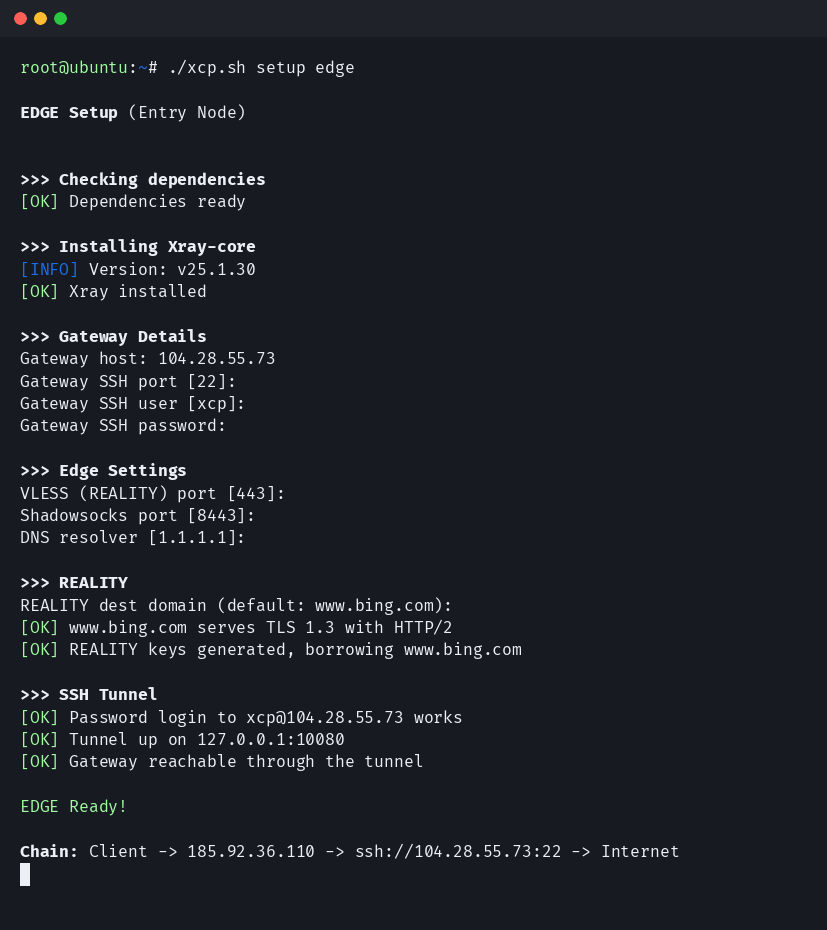

# Xray Chain Proxy

A chain proxy for bypassing internet censorship, built on [Xray-core](https://github.com/XTLS/Xray-core).



## How It Works

```
┌────────────┐      ┌────────────┐   SSH tunnel   ┌────────────┐      ┌──────────┐
│   Client   │ ──── │    EDGE    │ ═════════════► │  GATEWAY   │ ──── │ Internet │
│   (You)    │      │  (Entry)   │                │   (Exit)   │      │          │
└────────────┘      └────────────┘                └────────────┘      └──────────┘
```

| Server    | Location            | Role                                       |
| --------- | ------------------- | ------------------------------------------ |
| `EDGE`    | Restricted region   | Entry point - clients connect here         |
| `GATEWAY` | Unrestricted region | Exit point - fetches content from internet |

**Why two servers?**

Isolated networks block many websites. This tool creates a chain:

1. Your device connects to the **EDGE** server (in your region)
2. EDGE forwards traffic through an **SSH tunnel** to the **GATEWAY** server (unrestricted region)
3. GATEWAY fetches the content from the internet
4. Response travels back: Internet → GATEWAY → EDGE → Your device

**Benefits:**

- EDGE server has low latency (it's close to you)
- GATEWAY server has unrestricted internet access
- The server-to-server link is a plain SSH connection, so the GATEWAY exposes only `sshd` for the chain
- If EDGE gets blocked, you can easily replace it

## Supported Protocols

Both roles serve the same two protocols:

| Protocol        | Port | Method/Auth   | Best For                         |
| --------------- | ---- | ------------- | -------------------------------- |
| VLESS + REALITY | 443  | UUID + x25519 | Restricted networks, UDP, mobile |
| Shadowsocks     | 8443 | `aes-256-gcm` | Mobile apps, best compatibility  |

> One account covers both. Shadowsocks derives its key from the password, and VLESS sends its UUID inside the encrypted handshake.

### Ports

| Port    | EDGE     | GATEWAY  | Purpose                               |
| ------- | -------- | -------- | ------------------------------------- |
| `22`    | —        | Public   | SSH — the EDGE builds the tunnel here |
| `80`    | Public   | Public   | Answers with the caller's IP          |
| `443`   | Public   | Public   | VLESS + REALITY                       |
| `8443`  | Public   | Public   | Shadowsocks                           |
| `53`    | Loopback | Loopback | DNS resolver                          |
| `10080` | Loopback | Loopback | Tunnel endpoint on both servers       |
| `10085` | Loopback | Loopback | Xray stats API                        |
| `11080` | Loopback | Loopback | No-auth SOCKS5 for diagnostics        |

Open on the provider firewall — the same rules on both roles:

```
22, 80, 443, 8443/tcp
8443/udp
```

Shadowsocks is the only client protocol carrying UDP, so it is the only one that needs a UDP rule. Port 53 needs both, but only from clients you allow with `dns add`, so it gets a per-source rule instead.

REALITY holds 443 because that is what makes the disguise work: handshakes from unknown clients are proxied to the real `dest` site, so a prober gets a genuine TLS 1.3 answer with a valid certificate chain — on the port HTTPS is supposed to use. See [REALITY](advanced.md#reality) for the details.

## Features

- **VLESS+REALITY and Shadowsocks** - two client protocols, neither sending a credential in the clear
- **SSH chain link** - EDGE logs in to GATEWAY with a password and forwards a port
- **Dedicated tunnel user** - GATEWAY creates a shell-less `xcp` user for the link
- **Link health checks** - the tunnel is fetched through every 60s, and restarted when it stops carrying traffic
- **DNS built in** - Loopback port 53 on both servers, resolver switchable to DoH
- **Chain architecture** - Multiple hops for reliability and privacy
- **Strong encryption** - AES-256-GCM for clients, SSH for the chain
- **User management** - Unlimited accounts with QR codes
- **Traffic statistics** - Monitor bandwidth per user
- **Simple CLI** - Docker-style commands

## Prerequisites

**Server requirements:**

- Debian/Ubuntu with root access
- Minimum 512MB RAM, 1 CPU
- Both servers set up with this script — the EDGE links into the GATEWAY's Xray
- `sshd` running and reachable on the GATEWAY

See [Providers](providers.md) for VPS recommendations.

## Installation

### 1. Download

Run on **both** GATEWAY and EDGE servers:

```bash
curl -sL https://raw.githubusercontent.com/dalirnet/xray-chain-proxy/main/script.sh -o xcp.sh
chmod +x xcp.sh
```

### 2. Setup Gateway

On your exit server (unrestricted internet):

```bash
./xcp.sh setup gateway
```

You'll configure:

- VLESS (REALITY) port (default: 443)
- Shadowsocks port (default: 8443)
- DNS resolver (default: 1.1.1.1)
- REALITY dest domain (default: `www.bing.com`) — checked for TLS 1.3 and HTTP/2 before it is accepted
- Tunnel SSH password — press Enter to generate a 32-character one

Setup creates the `xcp` SSH user with that password, allows it in `sshd_config`, and prints everything the EDGE needs:

```
GATEWAY Ready!

Use on EDGE server (setup edge):
  Gateway:    1.2.3.4
  SSH Port:   22
  SSH User:   xcp
  SSH Pass:   kQ8vR2mZ...

Direct client access:
  VLESS Port: 443 (REALITY, borrowing www.bing.com)
  SS Port:    8443
  Username:   default
  Password:   xxxxxxxxxxxxxxxx

Loopback only (127.0.0.1):
  SOCKS Port: 11080 (diagnostics)
  DNS Port:   53 (1.1.1.1)
```

> Save the SSH password. It is shown once here, and edge setup asks for it.

### 3. Setup Edge

On your entry server:

```bash
./xcp.sh setup edge
```

Enter the gateway's SSH details when prompted:

- Gateway host (the GATEWAY's IP)
- Gateway SSH port (22)
- Gateway SSH user (`xcp`)
- Gateway SSH password (from gateway setup)

The script tests the login, starts the `xray-tunnel` service, fetches a page through the tunnel to confirm the gateway answers, and writes the Xray config.

## Connect Clients

### VLESS + REALITY

Import the URI from `./xcp.sh user ls` or scan the QR code from `./xcp.sh user add`. v2rayNG, Hiddify, Streisand, NekoBox, v2rayN and sing-box all read it directly:

```
vless://<uuid>@SERVER_IP:443?encryption=none&security=reality&type=tcp&flow=xtls-rprx-vision&sni=www.bing.com&fp=chrome&pbk=<public key>&sid=<shortId>&spx=%2F#name
```

To enter it by hand:

| Setting     | Value              |
| ----------- | ------------------ |
| Address     | EDGE or GATEWAY IP |
| Port        | 443                |
| UUID        | from `user ls`     |
| Flow        | `xtls-rprx-vision` |
| Security    | `reality`          |
| SNI         | the dest domain    |
| Fingerprint | `chrome`           |
| PublicKey   | from `user ls`     |
| ShortId     | from `user ls`     |

Clients reach the server by IP, and the SNI carries a domain someone else owns. If clients fail to connect while the server looks healthy, change that domain — `./xcp.sh config dest` switches it, and `./xcp.sh test` reports whether a client completes the handshake through it. REALITY authenticates with a timestamp, so keep both server clocks accurate — `chrony` or `systemd-timesyncd` handles it, and roughly 90 seconds of drift is the limit.

### Shadowsocks

Use any Shadowsocks client:

| Setting  | Value         |
| -------- | ------------- |
| Server   | EDGE IP       |
| Port     | 8443          |
| Password | (from setup)  |
| Method   | `aes-256-gcm` |

See [Clients](clients.md) for recommended apps.

### DNS

Queries arriving through either proxy protocol resolve through the chain automatically, using the resolver set with `./xcp.sh config set` → `dns`.

Devices where DNS is the only setting available — TVs, consoles, routers — can point their DNS at the server, once you allow them by address:

```bash
./xcp.sh dns add 203.0.113.9      # one client, or a block: 203.0.113.0/24
./xcp.sh dns ls                   # resolver, reachability, allowed sources
./xcp.sh dns rm  203.0.113.9
```

See [DNS access](commands.md#dns-access) for how the allowlist is enforced.

## Verify

Test the connection on EDGE server:

```bash
./xcp.sh test
```

Checks the SSH tunnel, proxies a request through the loopback SOCKS5 port to show the exit IP (should be GATEWAY's IP), resolves a name against the local resolver, and runs a speed test.

## Common Commands

```bash
./xcp.sh start          # Start service (and SSH tunnel)
./xcp.sh stop           # Stop service
./xcp.sh status         # Xray, tunnel, and link quality
./xcp.sh user ls        # List users
./xcp.sh user add       # Add user
./xcp.sh stats          # Traffic statistics
./xcp.sh config set     # Change ports, log level or DNS resolver
./xcp.sh dns ls         # Who may use the resolver
./xcp.sh link ls        # Show gateway SSH link
./xcp.sh link health    # Check the tunnel end to end
./xcp.sh update         # Update script and Xray
```

For full documentation see [Commands](commands.md).

## Under the Hood

### The SSH link

The link between servers is **always SSH**. VLESS+REALITY and Shadowsocks serve client connections only.

```
Xray (edge) ──► 127.0.0.1:10080 ──► ssh -L ──► gateway 127.0.0.1:10080 ──► Xray (gateway)
```

- A systemd unit `xray-tunnel` keeps the SSH connection alive, with keepalives and unlimited restarts
- Xray's `proxy` outbound is a SOCKS5 outbound pointing at the tunnel's local port
- The GATEWAY listens on the same loopback port with a `tunnel-in` SOCKS5 inbound, so the chain continues through its Xray and its routing rules
- Setup fetches a page through the tunnel to confirm the gateway answers before writing the config

The tunnel logs in with a password as `xcp`, a shell-less user the GATEWAY creates, restricted by a `Match User xcp` block to forwarding one port. Because that user is separate, the EDGE reaches the GATEWAY on providers that keep root SSH closed. See [SSH Tunnel Internals](advanced.md#ssh-tunnel-internals) for the full breakdown, and [Link Stability](advanced.md#link-stability) for the health checks and tuning.

### DNS

Both server types answer DNS on **`127.0.0.1:53`**, TCP and UDP:

```
client ──► EDGE proxy ──► dns-out ──► resolver (over TCP, through the tunnel)
```

Loopback keeps that service available to the chain while leaving both servers off the open-resolver abuse lists.

### UDP

SSH carries TCP. The EDGE answers client DNS through a `dns-out` outbound that resolves over TCP inside the chain, and drops other UDP — QUIC falls back to TCP automatically. Clients connecting straight to a GATEWAY over VLESS keep full UDP.

## Links

- [Xray-core Documentation](https://xtls.github.io/en/)
- [Project Repository](https://github.com/dalirnet/xray-chain-proxy)
- [Report Issues](https://github.com/dalirnet/xray-chain-proxy/issues)
