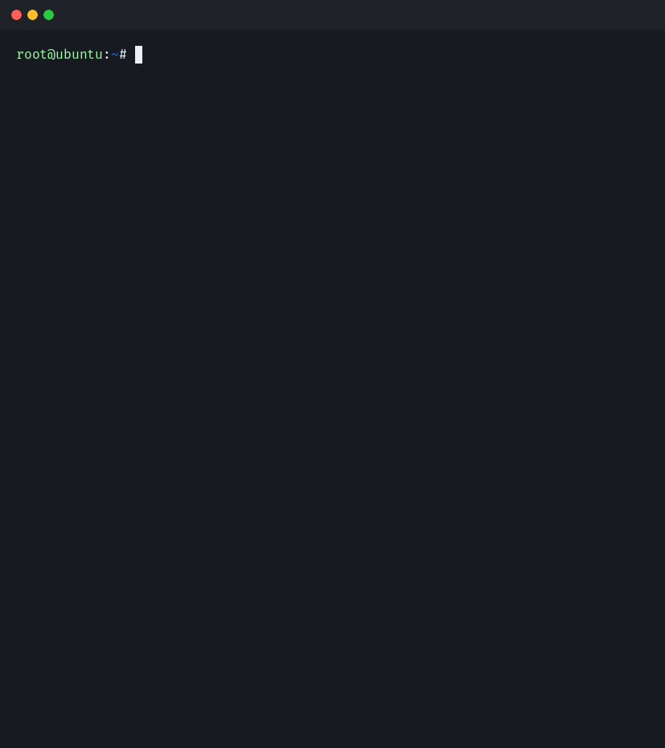
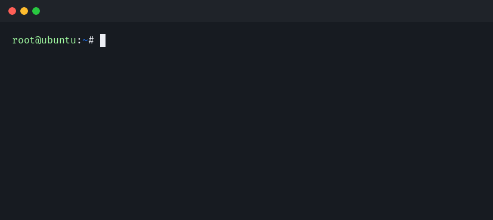
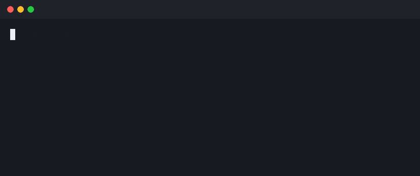
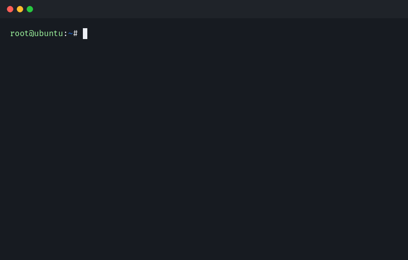
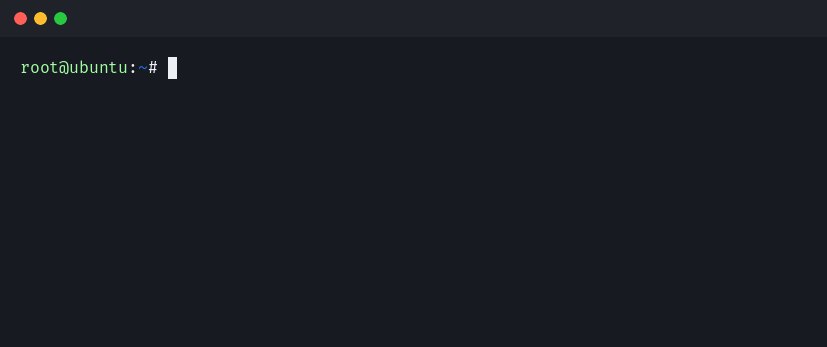
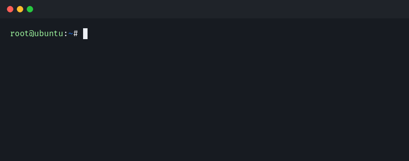

# Commands

## Setup

### `setup gateway`

Install and configure as exit node.

```bash
./xcp.sh setup gateway
```

Installs Xray and applies the BBR network tuning. It then asks for the server address — the detected public IP is the default, so Enter keeps it, or type another IP or domain; when detection fails, type it in. Share URIs use this address from then on. Next it asks which client protocols to offer — both (the default), VLESS+REALITY only, or Shadowsocks only — and prompts for the ports of those protocols, VLESS (443) and Shadowsocks (8443), plus IP echo (80), DNS (53) and a DNS resolver. Enter keeps each default.

With VLESS enabled, REALITY comes next: it asks for a `dest` domain (default `www.cloudflare.com`), checks that the domain answers with TLS 1.3 and HTTP/2, and generates the x25519 keypair and `shortId`.

Finally it sets up SSH access for the chain — the `xcp` tunnel user, its password (generated when left empty), and a `Match User xcp` block in `sshd_config` — creates the initial `default` user, and starts the IP responder. Prints the host, SSH port, user and password that edge setup asks for.


### `setup edge`

Install and configure as entry node.

```bash
./xcp.sh setup edge
```

Prompts for the server address the same way as the gateway, then the gateway's SSH details (host, port, user, password), then the same protocol choice and ports as the gateway, a DNS resolver and — with VLESS enabled — a REALITY `dest` domain. Each EDGE picks its protocols and gets its own keypair, independent of the gateway's.

It then starts the `xray-tunnel` service, fetches a page through it to confirm the gateway answers, and installs the `xray-tunnel-health.timer` that keeps checking every 60 seconds.



### When setup stops early

Setup that ends before Xray runs on the new config — an error, a failed check, or Ctrl+C — puts the server back the way it found it:

- A fresh server returns to an empty state: config, units, tunnel password, `sshd` block, `xcp` user and newly opened firewall rules are removed
- A re-run over a working install returns to that install: its config, units, `sshd_config`, the `xcp` user's password and resolver settings are restored, and the services that were running start again

The Xray binary, apt packages and network tuning stay, so the next run skips the download. Setup then runs again from a clean start.

## Service Control

### `start`

```bash
./xcp.sh start
```

### `stop`

```bash
./xcp.sh stop
```

### `restart`

```bash
./xcp.sh restart
```

> On an EDGE, `start` / `stop` / `restart` control the `xray-tunnel` service alongside Xray.

### `status`

```bash
./xcp.sh status
```

Shows running state, Xray version, and on EDGE servers the tunnel with its link quality.

```
Status:

Xray:   ● Running
Version: 24.12.18
Tunnel: ● Running
  RTT/jitter:  47.3/2.1 ms
  Retrans:     0/1841
Health: ● Checking every 60s
Echo:   ● Answering on port 80
```

`RTT/jitter` and `Retrans` are sampled from the tunnel's own socket with `ss -tin`. A retransmit total that climbs while the link is idle is the earliest sign of a shaped path — see [Reading link quality](advanced.md#reading-link-quality).



## User Management

### `user ls`

List all users with their passwords, plus a share URI for each protocol.

```bash
./xcp.sh user ls
```

Output:

```
Server: 5.6.7.8
VLESS: 443 (REALITY → www.cloudflare.com)
Shadowsocks: 8443

Accounts:

1) edge
   Password: xxxxxxxx
   VLESS URI: vless://...
   SS URI: ss://...
```

`--qr` adds a QR code above each share URI, and a username narrows the list to that one account — handy for handing a phone its links:

```bash
./xcp.sh user ls --qr
./xcp.sh user ls --qr bob
```

The QR codes need `qrencode`; setup installs it when it can.

### `user add`

Add new user interactively.

```bash
./xcp.sh user add
```

- Username: unique identifier
- Password: leave empty to auto-generate (asked when Shadowsocks is enabled)

One account covers every enabled protocol: the password authenticates Shadowsocks and a generated UUID authenticates VLESS. On a VLESS-only server the UUID is the whole credential, so there is no password prompt.

With `qrencode` installed it prints a QR code for each enabled protocol, VLESS first.


### `user rm`

Remove user by username.

```bash
./xcp.sh user rm
```

## Monitoring

### `stats`

Traffic statistics per user.

```bash
./xcp.sh stats
```



Output:

```
Users:
  edge: ↑1.2 MB ↓15.3 MB
  user1: ↑500 KB ↓2.1 MB

System:
  Inbound:  ↑1.7 MB ↓17.4 MB
  Outbound: ↑17.4 MB ↓1.7 MB
```

### `logs`

View access logs.

```bash
# Last 50 lines (default)
./xcp.sh logs

# Last 100 lines
./xcp.sh logs 100

# Follow in real-time
./xcp.sh logs -f
```

### `test`

Test proxy connection and speed.

```bash
./xcp.sh test
```

On EDGE: verifies the SSH tunnel carries traffic to the gateway. On both types: proxies a request through the loopback diagnostics SOCKS5 port (`127.0.0.1:11080`) to show the exit IP, resolves a name against the local resolver, and runs a speed test.



## Configuration

### `config ls`

Show current configuration.

```bash
./xcp.sh config ls
```

Output:

```
Config:

  Type:       edge
  Version:    3.x
  Address:    185.92.36.110
  VLESS Port: 443
  REALITY:    www.cloudflare.com
  SS Port:    8443
  Echo Port:  80
  SOCKS Port: 11080 (loopback)
  DNS Port:   53
  DNS Server: 1.1.1.1
  Log level:  error
  Gateway:    ssh://xcp@1.2.3.4:22
```

### `config set`

Change configuration interactively.

```bash
./xcp.sh config set
```

Options:

1. `loglevel` - Set log level (none/warning/info/debug)
2. `port` - Change listen ports
3. `dns` - Change the DNS resolver
4. `dest` - Change the site REALITY borrows its handshake from
5. `address` - Change the address share URIs point at

Each is also reachable directly, skipping the menu:

```bash
./xcp.sh config loglevel
./xcp.sh config port
./xcp.sh config dns
./xcp.sh config dest
./xcp.sh config address
```

### `config port`

Change the ports the server listens on.

```bash
./xcp.sh config port
```

```
Listen Ports

Current: VLESS:443 | SS:8443 | Echo:80 | DNS:53

VLESS (REALITY) port (default: 443):
Shadowsocks port (default: 8443):
IP echo port (default: 80): 8080
DNS port (default: 53): 5353
```

Each prompt defaults to the current port, so Enter keeps it.

| Port        | Default | What moves with it                                                      |
| ----------- | ------- | ----------------------------------------------------------------------- |
| VLESS       | `443`   | The inbound and every VLESS share URI                                   |
| Shadowsocks | `8443`  | The inbound and every SS share URI, with a TCP and a UDP firewall rule  |
| IP echo     | `80`    | The `xcp-web.socket` unit                                               |
| DNS         | `53`    | The `dns-in` inbound, and the `dns add` firewall rules for each client  |

The DNS port is where this server listens. Upstream resolvers and client queries routed through the chain still use 53.

Only the enabled protocols are asked about. Every port must be distinct and free, and must stay clear of the fixed loopback ports `10080`, `10085`, `11080` and `11081`. The command checks both before it writes anything, and opens the new ports when `ufw` is active. A moved VLESS or Shadowsocks port reissues the share URIs — run `user ls` and reimport them.

### `config dest`

Change the site REALITY borrows its handshake from.

```bash
./xcp.sh config dest
```

Answering TLS 1.3 with HTTP/2 makes a domain a candidate; completing a handshake a client can use makes it a working dest. Setup checks the first at the prompt and the second against the running inbound, so a domain that looks right and still drops clients is reported before you hand out URIs.

The SNI in every share URI is this name, so changing it reissues the URIs — run `user ls` and reimport them.

Known good: `www.cloudflare.com`, `dl.google.com`, `cdn.jsdelivr.net`, `www.speedtest.net`.

### `config address`

Change the address share URIs point at.

```bash
./xcp.sh config address
```

Setup stores this address in the config, and `user ls` and `user add` read it from there. The prompt offers the freshly detected public IP as the default; type a domain or another IP to use that instead. Detection asks `ifconfig.me` first and `api.ipmyp.ir` when the first gives no answer. Xray keeps running, and the share URIs are reissued — run `user ls` and reimport them.

### `config dns`

Change the DNS resolver.

```bash
./xcp.sh config dns
```

The DNS menu offers Cloudflare, Google and Quad9, two DoH endpoints, or a custom address. On an EDGE the choice is rewritten to `tcp://` so queries fit through the tunnel; a DoH URL is kept as typed. The change restarts Xray.

```
DNS Resolver

Current: 1.1.1.1

  1) 1.1.1.1                          - Cloudflare
  2) 8.8.8.8                          - Google
  3) 9.9.9.9                          - Quad9
  4) https://dns.google/dns-query     - Google DoH
  5) https://cloudflare-dns.com/dns-query - Cloudflare DoH
  6) custom
```

## DNS Access

The resolver answers on `127.0.0.1` by default, which serves the chain and keeps the server off the open-resolver abuse lists. These commands let named clients reach it — useful for devices where DNS is the only setting available, such as TVs, consoles and routers.

### `dns ls`

Show the resolver, whether it is reachable from outside, and who may use it.

```bash
./xcp.sh dns ls
```

```
DNS:

  Resolver: 1.1.1.1  (change with 'xcp.sh config set')
  Reachable: 0.0.0.0:53, allowed sources only

Allowed:

  1) 203.0.113.9
  2) 198.51.100.0/24
```



### `dns add`

Allow a client, by address or CIDR block.

```bash
./xcp.sh dns add 203.0.113.9
./xcp.sh dns add 198.51.100.0/24
./xcp.sh dns add                    # prompts
```

The first allowed client binds `dns-in` to `0.0.0.0` and writes the matching `ufw` rules for the DNS port (53 by default), TCP and UDP. Changing the port with `config port` moves these rules along with it.

`ufw` must be active — it is what enforces the list. While it is inactive the resolver stays on loopback and reports that. Prefixes shorter than `/8` prompt for confirmation.

### `dns rm`

Revoke a client.

```bash
./xcp.sh dns rm 203.0.113.9
```

Removing the last allowed client puts the resolver back on loopback.

## Routing Rules

### `rule ls`

List all custom routing rules.

```bash
./xcp.sh rule ls
```

Shows rule number, outbound tag, and matched domains/IPs.

### `rule add`

Add new routing rule interactively.

```bash
./xcp.sh rule add
```

Prompts for outbound (direct/proxy/blocked), rule type, and values.

See [Routing Rules](routing.md) for detailed examples.

### `rule rm`

Remove routing rule by number.

```bash
./xcp.sh rule rm
```

Shows current rules, prompts for rule number to remove.

## Gateway Link

EDGE servers only. The link to the GATEWAY is an SSH tunnel.

### `link ls`

Show the gateway link and tunnel state.

```bash
./xcp.sh link ls
```

Output:

```
Gateway Link:

  Protocol:   ssh
  Gateway:    xcp@1.2.3.4:22
  Auth:       password
  Forward:    127.0.0.1:10080 (loopback only)
  Tunnel:     ● Running
```



### `link set`

Point this EDGE at a different gateway.

```bash
./xcp.sh link set
```

Prompts for host, SSH port, SSH user and password, restarts the tunnel, verifies the new gateway answers, and rebuilds the config.

Users, ports, DNS resolver, log level and custom routing rules are preserved.

### `link restart`

Restart the SSH tunnel and Xray.

```bash
./xcp.sh link restart
```

Use this if the gateway rebooted or the connection is stuck.

### `link logs`

Show SSH tunnel logs.

```bash
./xcp.sh link logs        # last 50 lines
./xcp.sh link logs 200    # last 200 lines
```

Equivalent to `journalctl -u xray-tunnel`.

### `link health`

Fetch a page through the tunnel to confirm it carries traffic.

```bash
./xcp.sh link health
```

`xray-tunnel-health.timer` runs this every 60 seconds. Two consecutive failures restart the tunnel and Xray behind it, which catches a link that answers keepalives while its throughput has collapsed.

## Maintenance

### `update`

Update script and Xray to latest versions.

```bash
./xcp.sh update
```

Interactive menu to update:

- Script only (from GitHub)
- Xray only
- Both (recommended)

Configuration is preserved. Script backup saved as `script.sh.bak`.

### `uninstall`

Remove Xray completely.

```bash
./xcp.sh uninstall
```

Removes the binary, config, logs, systemd services and the stored tunnel password. On a GATEWAY it also deletes the `xcp` user and its `sshd_config` block, then reloads `sshd`.
