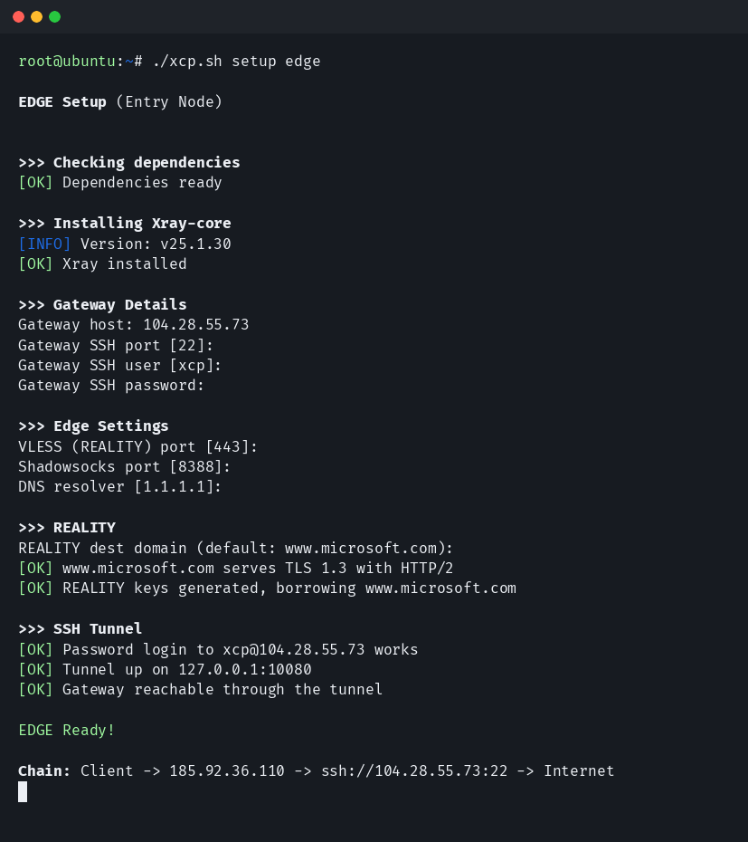

# Xray Chain Proxy

یک پروکسی زنجیره‌ای برای دور زدن سانسور اینترنت، بر پایه [Xray-core](https://github.com/XTLS/Xray-core).



## نحوه عملکرد

```
┌────────────┐      ┌────────────┐   SSH tunnel   ┌────────────┐      ┌──────────┐
│   Client   │ ──── │    EDGE    │ ═════════════► │  GATEWAY   │ ──── │ Internet │
│   (You)    │      │  (Entry)   │                │   (Exit)   │      │          │
└────────────┘      └────────────┘                └────────────┘      └──────────┘
```

| سرور      | موقعیت           | نقش                                       |
| --------- | ---------------- | ----------------------------------------- |
| `EDGE`    | منطقه محدودشده   | نقطه ورود؛ کلاینت‌ها به اینجا وصل می‌شوند |
| `GATEWAY` | منطقه بدون محدودیت | نقطه خروج؛ محتوا را از اینترنت می‌گیرد    |

**چرا دو سرور؟**

کاربران در شبکه‌های محدودشده به بسیاری از سایت‌ها دسترسی مستقیم ندارند. این ابزار یک زنجیره می‌سازد:

1. دستگاه شما به سرور **EDGE** (در منطقه خودتان) وصل می‌شود
2. سرور EDGE ترافیک را از یک **تونل SSH** به سرور **GATEWAY** (در منطقه آزاد) می‌فرستد
3. سرور GATEWAY محتوا را از اینترنت می‌گیرد
4. پاسخ برمی‌گردد: Internet ← GATEWAY ← EDGE ← دستگاه شما

**مزیت‌ها:**

- سرور EDGE تاخیر کمی دارد چون به شما نزدیک است
- سرور GATEWAY اینترنت بدون محدودیت دارد
- ارتباط بین دو سرور یک اتصال SSH ساده است، پس GATEWAY برای زنجیره فقط `sshd` را در معرض دید می‌گذارد
- اگر EDGE مسدود شود، به راحتی جایگزینش می‌کنید

## پروتکل‌های پشتیبانی شده

هر دو نقش همان دو پروتکل را سرویس می‌دهند:

| پروتکل          | پورت | روش/احراز هویت | بهترین برای                       |
| --------------- | ---- | -------------- | --------------------------------- |
| VLESS + REALITY | 443  | UUID + x25519  | شبکه‌های محدودشده، UDP، موبایل    |
| Shadowsocks     | 8388 | `aes-256-gcm`  | اپلیکیشن‌های موبایل، سازگاری بالا |

> یک حساب هر دو پروتکل را پوشش می‌دهد: رمز عبور برای Shadowsocks و یک UUID برای VLESS. هیچ‌کدام اعتبارنامه را به صورت متن ساده روی شبکه نمی‌فرستند.

### پورت‌ها

| پورت    | EDGE      | GATEWAY   | کاربرد                               |
| ------- | --------- | --------- | ------------------------------------ |
| `22`    | —         | عمومی     | SSH؛ EDGE تونل را از اینجا می‌سازد   |
| `80`    | عمومی     | عمومی     | پاسخ با آی‌پی درخواست‌کننده          |
| `443`   | عمومی     | عمومی     | VLESS + REALITY                      |
| `8388`  | عمومی     | عمومی     | Shadowsocks                          |
| `53`    | فقط لوکال | فقط لوکال | ریزالور DNS                          |
| `10080` | فقط لوکال | فقط لوکال | دو سر تونل روی هر دو سرور            |
| `10085` | فقط لوکال | فقط لوکال | API آمار Xray                        |
| `11080` | فقط لوکال | فقط لوکال | SOCKS5 بدون احراز هویت برای عیب‌یابی |

روی فایروال ارائه‌دهنده باز کنید — قوانین یکسان روی هر دو نقش:

```
22, 80, 443, 8388/tcp
8388/udp
```

از میان پروتکل‌های کلاینت تنها Shadowsocks ترافیک UDP را حمل می‌کند، پس تنها همان به قانون UDP نیاز دارد. پورت ۵۳ به هر دو نیاز دارد، ولی فقط از سمت کلاینت‌هایی که با `dns add` مجاز می‌کنید، پس به جای آن قانون مخصوص همان مبدا می‌گیرد.

REALITY پورت ۴۴۳ را در اختیار می‌گیرد و همین چیزی است که پوشش را کارآمد می‌کند: دست‌دادن‌هایی که نمی‌شناسد به سایت واقعی `dest` منتقل می‌شوند، پس یک پروب یک پاسخ واقعی TLS 1.3 با زنجیره گواهی معتبر می‌گیرد، آن هم روی پورتی که HTTPS باید از آن استفاده کند. جزئیات در بخش [REALITY](advanced.md#reality).

## امکانات

- **VLESS+REALITY و Shadowsocks** - دو پروتکل کلاینت که هیچ‌کدام اعتبارنامه را به صورت متن ساده نمی‌فرستند
- **لینک SSH بین سرورها** - EDGE با رمز عبور وارد GATEWAY می‌شود و یک پورت را فوروارد می‌کند
- **کاربر اختصاصی تونل** - GATEWAY کاربر بدون شل `xcp` را برای این لینک می‌سازد
- **بررسی سلامت لینک** - هر ۶۰ ثانیه از داخل تونل یک درخواست فرستاده می‌شود و اگر ترافیک عبور نکند تونل ری‌استارت می‌شود
- **DNS داخلی** - پورت لوکال ۵۳ روی هر دو سرور با امکان تغییر ریزالور به DoH
- **معماری زنجیره‌ای** - چندین هاپ برای پایداری و حریم خصوصی
- **رمزنگاری قوی** - AES-256-GCM برای کلاینت‌ها و SSH برای زنجیره
- **مدیریت کاربران** - ایجاد حساب‌های نامحدود با QR کد
- **آمار ترافیک** - نظارت بر پهنای باند هر کاربر
- **CLI ساده** - دستورات به سبک Docker

## پیش‌نیازها

**نیازمندی‌های سرور:**

- Debian/Ubuntu با دسترسی root
- حداقل 512MB RAM، 1 CPU
- هر دو سرور با همین اسکریپت راه‌اندازی شوند؛ EDGE به Xray سرور GATEWAY وصل می‌شود
- سرویس `sshd` روی GATEWAY در دسترس باشد

برای پیشنهاد VPS به صفحه ارائه‌دهندگان مراجعه کنید.

## نصب

### 1. دانلود

روی **هر دو** سرور GATEWAY و EDGE اجرا کنید:

```bash
curl -sL https://raw.githubusercontent.com/dalirnet/xray-chain-proxy/main/script.sh -o xcp.sh
chmod +x xcp.sh
```

### 2. راه‌اندازی Gateway

روی سرور خروجی (با اینترنت آزاد):

```bash
./xcp.sh setup gateway
```

تنظیمات:

- پورت VLESS (REALITY) (پیش‌فرض: 443)
- پورت Shadowsocks (پیش‌فرض: 8388)
- ریزالور DNS (پیش‌فرض: 1.1.1.1)
- دامنه dest برای REALITY (پیش‌فرض: `www.microsoft.com`) — پیش از پذیرش، پشتیبانی از TLS 1.3 و HTTP/2 آن بررسی می‌شود
- رمز SSH تونل — با زدن Enter یک رمز ۳۲ کاراکتری ساخته می‌شود

اسکریپت کاربر `xcp` را با همان رمز می‌سازد، آن را در `sshd_config` مجاز می‌کند و هر چیزی که EDGE لازم دارد را نمایش می‌دهد:

```
GATEWAY Ready!

Use on EDGE server (setup edge):
  Gateway:    1.2.3.4
  SSH Port:   22
  SSH User:   xcp
  SSH Pass:   kQ8vR2mZ...

Direct client access:
  VLESS Port: 443 (REALITY, borrowing www.microsoft.com)
  SS Port:    8388
  Username:   default
  Password:   xxxxxxxxxxxxxxxx

Loopback only (127.0.0.1):
  SOCKS Port: 11080 (diagnostics)
  DNS Port:   53 (1.1.1.1)
```

> رمز SSH را ذخیره کنید؛ فقط همین یک بار نمایش داده می‌شود و هنگام راه‌اندازی EDGE لازم است.

### 3. راه‌اندازی Edge

روی سرور ورودی:

```bash
./xcp.sh setup edge
```

اطلاعات SSH سرور GATEWAY را وارد کنید:

- آدرس GATEWAY
- پورت SSH (22)
- کاربر SSH (`xcp`)
- رمز SSH (از مرحله قبل)

اسکریپت ورود را تست می‌کند، سرویس `xray-tunnel` را اجرا می‌کند، یک درخواست از داخل تونل می‌فرستد تا پاسخ‌دهی GATEWAY تایید شود و بعد کانفیگ Xray را می‌نویسد.

## اتصال کلاینت‌ها

### VLESS + REALITY

لینک اشتراک را از `./xcp.sh user ls` وارد کنید یا QR کد `./xcp.sh user add` را اسکن کنید. برنامه‌های v2rayNG، Hiddify، Streisand، NekoBox، v2rayN و sing-box آن را مستقیم می‌خوانند:

```
vless://<uuid>@SERVER_IP:443?encryption=none&security=reality&type=tcp&flow=xtls-rprx-vision&sni=www.microsoft.com&fp=chrome&pbk=<public key>&sid=<shortId>&spx=%2F#name
```

برای وارد کردن دستی:

| تنظیم       | مقدار                 |
| ----------- | --------------------- |
| Address     | آی‌پی EDGE یا GATEWAY |
| Port        | 443                   |
| UUID        | از `user ls`          |
| Flow        | `xtls-rprx-vision`    |
| Security    | `reality`             |
| SNI         | دامنه dest            |
| Fingerprint | `chrome`              |
| PublicKey   | از `user ls`          |
| ShortId     | از `user ls`          |

پروتکل REALITY به دامنه اختصاصی شما نیاز ندارد؛ کلاینت‌ها با آی‌پی به سرور می‌رسند و SNI نام دامنه‌ای را حمل می‌کند که متعلق به شخص دیگری است. احراز هویت REALITY بر پایه زمان هم هست، پس ساعت هر دو سرور باید دقیق باشد: بیش از حدود ۹۰ ثانیه اختلاف و اتصال کلاینت‌ها شکست می‌خورد. `chrony` یا `systemd-timesyncd` این را حل می‌کند.

### Shadowsocks

از هر کلاینت Shadowsocks استفاده کنید:

| تنظیم    | مقدار           |
| -------- | --------------- |
| Server   | آی‌پی EDGE      |
| Port     | 8388            |
| Password | (از راه‌اندازی) |
| Method   | `aes-256-gcm`   |

برای اپلیکیشن‌های پیشنهادی صفحه کلاینت‌ها را ببینید.

### DNS

درخواست‌هایی که از هر کدام از دو پروتکل پروکسی می‌رسند به صورت خودکار از داخل زنجیره ریزالو می‌شوند، با ریزالوری که با `./xcp.sh config set` و گزینه `dns` انتخاب کرده‌اید.

دستگاه‌هایی که پروکسی اجرا نمی‌کنند — تلویزیون، کنسول، روتر — می‌توانند به جای آن DNS خود را روی سرور بگذارند، به شرطی که اول با آدرس مجازشان کنید:

```bash
./xcp.sh dns add 203.0.113.9      # یک کلاینت، یا یک بلوک: 203.0.113.0/24
./xcp.sh dns ls                   # ریزالور، دسترس‌پذیری و فهرست مجاز
./xcp.sh dns rm  203.0.113.9
```

نحوه اعمال شدن این فهرست در بخش [دسترسی DNS](commands.md#دسترسی-dns) توضیح داده شده است.

## تست اتصال

روی سرور EDGE:

```bash
./xcp.sh test
```

ابتدا عبور ترافیک از تونل SSH بررسی می‌شود، سپس یک درخواست از پورت SOCKS5 لوکال می‌گذرد تا آی‌پی خروجی (باید آی‌پی GATEWAY باشد) نمایش داده شود، بعد یک نام با ریزالور محلی ریزالو می‌شود و در پایان تست سرعت اجرا می‌شود.

## دستورات رایج

```bash
./xcp.sh start          # شروع سرویس (و تونل SSH)
./xcp.sh stop           # توقف سرویس
./xcp.sh status         # وضعیت Xray، تونل و کیفیت لینک
./xcp.sh user ls        # لیست کاربران
./xcp.sh user add       # افزودن کاربر
./xcp.sh stats          # آمار ترافیک
./xcp.sh config set     # تغییر پورت‌ها، سطح لاگ یا ریزالور DNS
./xcp.sh dns ls         # چه کسی می‌تواند از ریزالور استفاده کند
./xcp.sh link ls        # نمایش لینک SSH گیت‌وی
./xcp.sh link health    # بررسی تونل به صورت سرتاسری
./xcp.sh update         # بروزرسانی اسکریپت و Xray
```

برای مستندات کامل صفحه دستورات را ببینید.

## زیر پوسته

### لینک SSH

ارتباط بین سرورها **همیشه SSH** است. VLESS+REALITY و Shadowsocks فقط به اتصال کلاینت‌ها سرویس می‌دهند.

```
Xray (edge) ──► 127.0.0.1:10080 ──► ssh -L ──► gateway 127.0.0.1:10080 ──► Xray (gateway)
```

- یک سرویس systemd به نام `xray-tunnel` اتصال SSH را با keepalive و تلاش نامحدود برای اتصال مجدد برقرار نگه می‌دارد
- خروجی (outbound) با تگ `proxy` در Xray یک SOCKS5 است که به پورت محلی تونل وصل می‌شود
- GATEWAY روی همان پورت لوکال یک ورودی SOCKS5 با تگ `tunnel-in` دارد، پس زنجیره از داخل Xray و قوانین مسیریابی آن ادامه پیدا می‌کند
- هنگام نصب یک درخواست از داخل تونل ارسال می‌شود تا پیش از نوشتن کانفیگ، پاسخ‌دهی GATEWAY تایید شود

تونل با رمز عبور و با کاربر `xcp` وارد می‌شود؛ کاربری بدون شل که GATEWAY می‌سازد و با بلوک `Match User xcp` فقط به فوروارد همان یک پورت محدود می‌شود. چون کاربر تونل جداست، EDGE روی سرورهایی که ورود root با SSH بسته است هم به GATEWAY می‌رسد. جزئیات کامل در بخش [جزئیات تونل SSH](advanced.md#جزئیات-تونل-ssh) و [پایداری لینک](advanced.md#پایداری-لینک).

### DNS

هر دو نوع سرور روی **`127.0.0.1:53`** (هم TCP و هم UDP) به درخواست‌های DNS پاسخ می‌دهند:

```
client ──► EDGE proxy ──► dns-out ──► resolver (روی TCP و از داخل تونل)
```

محدود کردن به لوکال، این سرویس را برای زنجیره در دسترس نگه می‌دارد و هر دو سرور را از فهرست‌های سوءاستفاده از ریزالورهای باز دور نگه می‌دارد.

### UDP

تونل SSH ترافیک TCP را عبور می‌دهد. درخواست‌های DNS کلاینت‌ها با خروجی `dns-out` روی TCP و از داخل زنجیره پاسخ داده می‌شود و بقیه ترافیک UDP دور ریخته می‌شود — QUIC به صورت خودکار به TCP برمی‌گردد. کلاینت‌هایی که مستقیم با VLESS به یک GATEWAY وصل می‌شوند UDP کامل دارند.

## لینک‌ها

- [مستندات Xray-core](https://xtls.github.io/)
- [مخزن پروژه](https://github.com/dalirnet/xray-chain-proxy)
