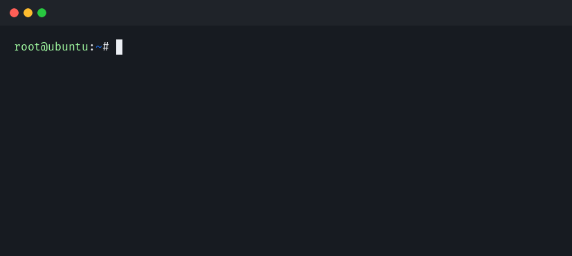
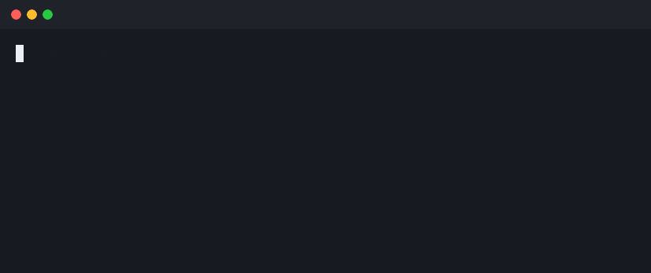
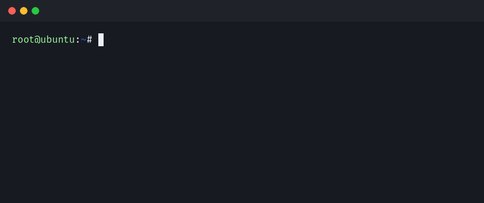

# دستورات

## راه‌اندازی

### `setup gateway`

نصب و پیکربندی به عنوان نود خروجی.

```bash
./xcp.sh setup gateway
```

ابتدا Xray را نصب می‌کند، تنظیمات شبکه BBR را اعمال می‌کند و بعد پورت‌ها و ریزالور DNS را می‌پرسد.

مرحله بعد REALITY است: دامنه `dest` را می‌پرسد (پیش‌فرض `www.microsoft.com`)، بررسی می‌کند که آن دامنه با TLS 1.3 و HTTP/2 پاسخ می‌دهد، و جفت‌کلید x25519 و `shortId` را می‌سازد.

در پایان دسترسی SSH زنجیره را آماده می‌کند — کاربر `xcp`، رمز آن (اگر خالی بگذارید ساخته می‌شود) و بلوک `Match User xcp` در `sshd_config` — کاربر اولیه `default` را می‌سازد و پاسخ‌دهنده آی‌پی روی پورت ۸۰ را راه می‌اندازد. سپس آدرس، پورت، کاربر و رمزی که هنگام راه‌اندازی EDGE لازم است نمایش داده می‌شود.


### `setup edge`

نصب و پیکربندی به عنوان نود ورودی.

```bash
./xcp.sh setup edge
```

اطلاعات SSH سرور GATEWAY (آدرس، پورت، کاربر، رمز) و سپس پورت‌های محلی، ریزالور DNS و دامنه `dest` برای REALITY را می‌پرسد — هر EDGE جفت‌کلید مستقل خودش را می‌گیرد.

بعد سرویس `xray-tunnel` را اجرا می‌کند، یک درخواست از داخل تونل می‌فرستد تا پاسخ‌دهی GATEWAY تایید شود، و تایمر `xray-tunnel-health.timer` را نصب می‌کند که هر ۶۰ ثانیه بررسی را ادامه می‌دهد.


## کنترل سرویس

### `start`

```bash
./xcp.sh start
```

### `stop`

```bash
./xcp.sh stop
```

### `restart`

```bash
./xcp.sh restart
```

> روی EDGE، دستورهای `start` / `stop` / `restart` سرویس `xray-tunnel` را هم همراه Xray کنترل می‌کنند.

### `status`

```bash
./xcp.sh status
```

وضعیت اجرا، نسخه Xray و روی سرورهای EDGE وضعیت تونل به همراه کیفیت لینک را نمایش می‌دهد.

```
Status:

Xray:   ● Running
Version: 24.12.18
Tunnel: ● Running
  RTT/jitter:  47.3/2.1 ms
  Retrans:     0/1841
Health: ● Checking every 60s
Echo:   ● Answering on port 80
```

مقادیر `RTT/jitter` و `Retrans` با `ss -tin` از خود سوکت تونل خوانده می‌شوند. رشد تعداد ارسال مجدد در حالت بیکار، اولین نشانه یک مسیر شکل‌داده‌شده است — بخش [خواندن کیفیت لینک](advanced.md#خواندن-کیفیت-لینک) را ببینید.



## مدیریت کاربران

### `user ls`

لیست همه کاربران با رمز عبور، به همراه یک لینک اشتراک برای هر پروتکل.

```bash
./xcp.sh user ls
```

خروجی:

```
Server: 5.6.7.8
VLESS: 443 (REALITY → www.microsoft.com)
Shadowsocks: 8388

Accounts:

1) edge
   Password: xxxxxxxx
   SS URI: ss://...
   VLESS URI: vless://...
```

### `user add`

افزودن کاربر جدید.

```bash
./xcp.sh user add
```

- نام کاربری: شناسه یکتا
- رمز عبور: خالی بگذارید برای تولید خودکار

یک حساب هر دو پروتکل را پوشش می‌دهد: رمز عبور برای Shadowsocks و یک UUID تولیدشده برای VLESS.

اگر `qrencode` نصب باشد یک QR کد چاپ می‌شود — در حالتی که REALITY تنظیم شده باشد، QR مربوط به لینک VLESS است، چون روی شبکه‌های محدودشده همان گزینه اصلی است.


### `user rm`

حذف کاربر.

```bash
./xcp.sh user rm
```

## مانیتورینگ

### `stats`

آمار ترافیک هر کاربر.

```bash
./xcp.sh stats
```



خروجی:

```
Users:
  edge: ↑1.2 MB ↓15.3 MB
  user1: ↑500 KB ↓2.1 MB

System:
  Inbound:  ↑1.7 MB ↓17.4 MB
  Outbound: ↑17.4 MB ↓1.7 MB
```

### `logs`

مشاهده لاگ‌ها.

```bash
# ۵۰ خط آخر (پیش‌فرض)
./xcp.sh logs

# ۱۰۰ خط آخر
./xcp.sh logs 100

# دنبال کردن لحظه‌ای
./xcp.sh logs -f
```

### `test`

تست اتصال پروکسی و سرعت.

```bash
./xcp.sh test
```

روی EDGE: ابتدا عبور ترافیک از تونل SSH تا GATEWAY بررسی می‌شود. روی هر دو نوع سرور: یک درخواست از پورت SOCKS5 عیب‌یابی روی لوکال (`127.0.0.1:11080`) عبور می‌کند تا آی‌پی خروجی مشخص شود، یک نام با ریزالور محلی ریزالو می‌شود و تست سرعت اجرا می‌شود.


## پیکربندی

### `config ls`

نمایش تنظیمات فعلی.

```bash
./xcp.sh config ls
```

خروجی:

```
Config:

  Type:       edge
  Version:    3.x
  VLESS Port: 443
  REALITY:    www.microsoft.com
  SS Port:    8388
  SOCKS Port: 11080 (loopback)
  DNS Port:   53 (loopback)
  DNS Server: 1.1.1.1
  Log level:  error
  Gateway:    ssh://xcp@1.2.3.4:22
```

### `config set`

تغییر تنظیمات.

```bash
./xcp.sh config set
```

گزینه‌ها:

1. `loglevel` - سطح لاگ (none/warning/info/debug)
2. `port` - تغییر پورت‌ها
3. `dns` - تغییر ریزالور DNS

هر کدام مستقیم و بدون عبور از منو هم در دسترس هستند:

```bash
./xcp.sh config loglevel
./xcp.sh config port
./xcp.sh config dns
```

منوی DNS گزینه‌های Cloudflare، Google و Quad9، دو آدرس DoH و ورود آدرس دلخواه را دارد. روی EDGE انتخاب شما به شکل `tcp://` نوشته می‌شود تا از تونل عبور کند و آدرس DoH همان‌طور که وارد شده ذخیره می‌شود. با این تغییر Xray ری‌استارت می‌شود.

```
DNS Resolver

Current: 1.1.1.1

  1) 1.1.1.1                          - Cloudflare
  2) 8.8.8.8                          - Google
  3) 9.9.9.9                          - Quad9
  4) https://dns.google/dns-query     - Google DoH
  5) https://cloudflare-dns.com/dns-query - Cloudflare DoH
  6) custom
```

## دسترسی DNS

ریزالور به صورت پیش‌فرض روی `127.0.0.1` پاسخ می‌دهد؛ این حالت زنجیره را سرویس می‌دهد و سرور را از فهرست‌های سوءاستفاده از ریزالورهای باز دور نگه می‌دارد. این دستورها به کلاینت‌های مشخصی اجازه دسترسی می‌دهند — مفید برای دستگاه‌هایی که پروکسی اجرا نمی‌کنند ولی می‌توانند DNS تنظیم کنند.

### `dns ls`

نمایش ریزالور، وضعیت دسترس‌پذیری از بیرون، و فهرست مجاز.

```bash
./xcp.sh dns ls
```

```
DNS:

  Resolver: 1.1.1.1  (change with 'xcp.sh config set')
  Reachable: 0.0.0.0:53, allowed sources only

Allowed:

  1) 203.0.113.9
  2) 198.51.100.0/24
```



### `dns add`

اجازه دادن به یک کلاینت، با آدرس یا بلوک CIDR.

```bash
./xcp.sh dns add 203.0.113.9
./xcp.sh dns add 198.51.100.0/24
./xcp.sh dns add                    # پرسش تعاملی
```

اولین کلاینت مجاز، `dns-in` را روی `0.0.0.0` می‌برد و قوانین `ufw` را برای 53/tcp و 53/udp می‌نویسد.

فایروال `ufw` باید فعال باشد؛ همان چیزی است که فهرست را اعمال می‌کند. اگر غیرفعال باشد ریزالور روی لوکال می‌ماند و همین را اعلام می‌کند. پیشوندهای کوتاه‌تر از `/8` تاییدیه می‌گیرند.

### `dns rm`

لغو دسترسی یک کلاینت.

```bash
./xcp.sh dns rm 203.0.113.9
```

حذف آخرین کلاینت مجاز، ریزالور را به لوکال برمی‌گرداند.

## قوانین مسیریابی

### `rule ls`

لیست همه قوانین مسیریابی سفارشی.

```bash
./xcp.sh rule ls
```

شماره قانون، تگ خروجی و دامنه‌ها/IPهای منطبق را نمایش می‌دهد.

### `rule add`

افزودن قانون مسیریابی جدید به صورت تعاملی.

```bash
./xcp.sh rule add
```

خروجی (direct/proxy/blocked)، نوع قانون و مقادیر را درخواست می‌کند.

برای مثال‌های کامل به [قوانین مسیریابی](routing.md) مراجعه کنید.

### `rule rm`

حذف قانون مسیریابی با شماره.

```bash
./xcp.sh rule rm
```

قوانین فعلی را نمایش داده، شماره قانون را برای حذف درخواست می‌کند.

## لینک گیت‌وی

فقط روی سرورهای EDGE. ارتباط با GATEWAY یک تونل SSH است.

### `link ls`

نمایش لینک گیت‌وی و وضعیت تونل.

```bash
./xcp.sh link ls
```

خروجی:

```
Gateway Link:

  Protocol:   ssh
  Gateway:    xcp@1.2.3.4:22
  Auth:       password
  Forward:    127.0.0.1:10080 (loopback only)
  Tunnel:     ● Running
```


### `link set`

تغییر گیت‌وی این EDGE.

```bash
./xcp.sh link set
```

آدرس، پورت SSH، کاربر و رمز را می‌پرسد، تونل را ری‌استارت می‌کند، پاسخ‌دهی گیت‌وی جدید را تایید می‌کند و کانفیگ را بازسازی می‌کند.

کاربران، پورت‌ها، ریزالور DNS، سطح لاگ و قوانین مسیریابی سفارشی حفظ می‌شوند.

### `link restart`

ری‌استارت تونل SSH و Xray.

```bash
./xcp.sh link restart
```

اگر GATEWAY ری‌استارت شده یا اتصال گیر کرده، از این دستور استفاده کنید.

### `link logs`

نمایش لاگ‌های تونل SSH.

```bash
./xcp.sh link logs        # ۵۰ خط آخر
./xcp.sh link logs 200    # ۲۰۰ خط آخر
```

### `link health`

یک صفحه را از داخل تونل می‌گیرد تا عبور واقعی ترافیک تایید شود.

```bash
./xcp.sh link health
```

تایمر `xray-tunnel-health.timer` این را هر ۶۰ ثانیه اجرا می‌کند. دو شکست پشت سر هم، تونل و Xray پشت آن را ری‌استارت می‌کند؛ همان چیزی که لینکی را می‌گیرد که به keepalive پاسخ می‌دهد ولی تقریبا هیچ داده‌ای عبور نمی‌دهد.

معادل `journalctl -u xray-tunnel`.

## نگهداری

### `update`

بروزرسانی اسکریپت و Xray به آخرین نسخه.

```bash
./xcp.sh update
```

منوی تعاملی برای بروزرسانی:
- فقط اسکریپت (از GitHub)
- فقط Xray
- هر دو (پیشنهادی)

تنظیمات حفظ می‌شود. نسخه پشتیبان اسکریپت به عنوان `script.sh.bak` ذخیره می‌شود.

### `uninstall`

حذف کامل Xray.

```bash
./xcp.sh uninstall
```

باینری، تنظیمات، لاگ‌ها، سرویس‌های systemd و رمز ذخیره‌شده تونل حذف می‌شود. روی GATEWAY کاربر `xcp` و بلوک آن در `sshd_config` هم حذف و `sshd` دوباره بارگذاری می‌شود.
