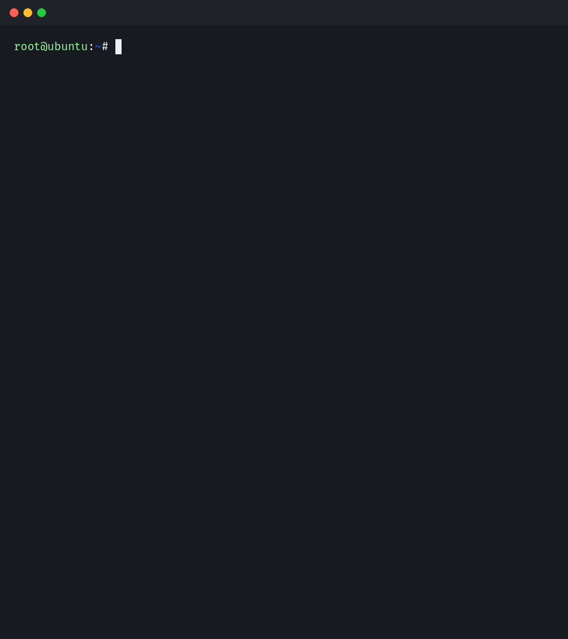
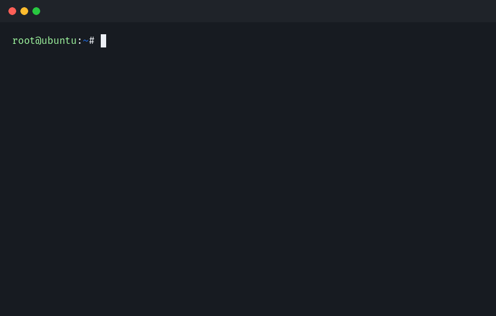
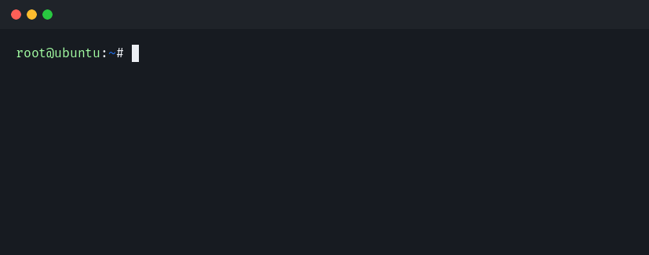

# دستورات

## راه‌اندازی

### `setup gateway`

نصب و پیکربندی به عنوان نود خروجی.

```bash
./xcp.sh setup gateway
```

ابتدا Xray را نصب می‌کند و تنظیمات شبکه BBR را اعمال می‌کند. سپس آدرس سرور را می‌پرسد — آی‌پی عمومی شناسایی‌شده پیش‌فرض است، پس با Enter همان می‌ماند، یا آی‌پی یا دامنه دیگری وارد کنید؛ اگر شناسایی ناموفق باشد، آدرس را خودتان وارد می‌کنید. لینک‌های اشتراک از آن پس همین آدرس را به کار می‌برند. بعد می‌پرسد کدام پروتکل‌های کلاینت ارائه شوند — هر دو (پیش‌فرض)، فقط VLESS+REALITY یا فقط Shadowsocks — و پورت همان پروتکل‌ها، یعنی VLESS (443) و Shadowsocks (8443)، به همراه پاسخ‌دهنده آی‌پی (80)، DNS (53) و ریزالور DNS را می‌پرسد. با Enter مقدار پیش‌فرض هر کدام می‌ماند.

با VLESS فعال، مرحله بعد REALITY است: دامنه `dest` را می‌پرسد (پیش‌فرض `www.cloudflare.com`)، بررسی می‌کند که آن دامنه با TLS 1.3 و HTTP/2 پاسخ می‌دهد، و جفت‌کلید x25519 و `shortId` را می‌سازد.

در پایان دسترسی SSH زنجیره را آماده می‌کند — کاربر `xcp`، رمز آن (اگر خالی بگذارید ساخته می‌شود) و بلوک `Match User xcp` در `sshd_config` — کاربر اولیه `default` را می‌سازد و پاسخ‌دهنده آی‌پی را راه می‌اندازد. سپس آدرس، پورت، کاربر و رمزی که هنگام راه‌اندازی EDGE لازم است نمایش داده می‌شود.


### `setup edge`

نصب و پیکربندی به عنوان نود ورودی.

```bash
./xcp.sh setup edge
```

آدرس سرور را مانند GATEWAY می‌پرسد، سپس اطلاعات SSH سرور GATEWAY (آدرس، پورت، کاربر، رمز) و بعد همان انتخاب پروتکل و پورت‌های GATEWAY، ریزالور DNS و — با VLESS فعال — دامنه `dest` برای REALITY را می‌پرسد. هر EDGE پروتکل‌های خودش را انتخاب می‌کند و جفت‌کلید مستقل خودش را می‌گیرد.

بعد سرویس `xray-tunnel` را اجرا می‌کند، یک درخواست از داخل تونل می‌فرستد تا پاسخ‌دهی GATEWAY تایید شود، و تایمر `xray-tunnel-health.timer` را نصب می‌کند که هر ۶۰ ثانیه بررسی را ادامه می‌دهد.



### وقتی راه‌اندازی نیمه‌کاره متوقف شود

اگر راه‌اندازی پیش از اجرای Xray با کانفیگ جدید تمام شود — با خطا، شکست یک بررسی یا Ctrl+C — سرور را به همان حالتی برمی‌گرداند که پیدا کرده بود:

- سرور تازه به حالت خالی برمی‌گردد: کانفیگ، یونیت‌ها، رمز تونل، بلوک `sshd`، کاربر `xcp` و قوانین فایروالی که تازه باز شده‌اند حذف می‌شوند
- اجرای دوباره روی نصبی که کار می‌کرد به همان نصب برمی‌گردد: کانفیگ، یونیت‌ها، `sshd_config`، رمز کاربر `xcp` و تنظیمات ریزالور بازگردانده می‌شوند و سرویس‌هایی که در حال اجرا بودند دوباره راه می‌افتند

فایل اجرایی Xray، بسته‌های apt و تنظیمات شبکه باقی می‌مانند تا اجرای بعدی دانلود را تکرار نکند. راه‌اندازی بعدی از یک شروع تمیز اجرا می‌شود.

## کنترل سرویس

### `start`

```bash
./xcp.sh start
```

### `stop`

```bash
./xcp.sh stop
```

### `restart`

```bash
./xcp.sh restart
```

> روی EDGE، دستورهای `start` / `stop` / `restart` سرویس `xray-tunnel` را هم همراه Xray کنترل می‌کنند.

### `status`

```bash
./xcp.sh status
```

وضعیت اجرا، نسخه Xray و روی سرورهای EDGE وضعیت تونل به همراه کیفیت لینک را نمایش می‌دهد.

```
Status:

Xray:   ● Running
Version: 24.12.18
Tunnel: ● Running
  RTT/jitter:  47.3/2.1 ms
  Retrans:     0/1841
Health: ● Checking every 60s
Echo:   ● Answering on port 80
```

مقادیر `RTT/jitter` و `Retrans` با `ss -tin` از خود سوکت تونل خوانده می‌شوند. رشد تعداد ارسال مجدد در حالت بیکار، اولین نشانه یک مسیر شکل‌داده‌شده است — بخش [خواندن کیفیت لینک](advanced.md#خواندن-کیفیت-لینک) را ببینید.


## مدیریت کاربران

### `user ls`

لیست همه کاربران با رمز عبور، به همراه یک لینک اشتراک برای هر پروتکل.

```bash
./xcp.sh user ls
```

خروجی:

```
Server: 5.6.7.8
VLESS: 443 (REALITY → www.cloudflare.com)
Shadowsocks: 8443

Accounts:

1) edge
   Password: xxxxxxxx
   VLESS URI: vless://...
   SS URI: ss://...
```

گزینه `--qr` بالای هر لینک اشتراک یک QR کد اضافه می‌کند و نام کاربری، لیست را به همان یک حساب محدود می‌کند — برای دادن لینک‌ها به یک گوشی مناسب است:

```bash
./xcp.sh user ls --qr
./xcp.sh user ls --qr bob
```

QR کدها به `qrencode` نیاز دارند؛ راه‌اندازی در صورت امکان آن را نصب می‌کند.

### `user add`

افزودن کاربر جدید.

```bash
./xcp.sh user add
```

- نام کاربری: شناسه یکتا
- رمز عبور: خالی بگذارید برای تولید خودکار (وقتی Shadowsocks فعال است پرسیده می‌شود)

یک حساب همه پروتکل‌های فعال را پوشش می‌دهد: رمز عبور برای Shadowsocks و یک UUID تولیدشده برای VLESS. روی سرور فقط VLESS، شناسه UUID کل اعتبارنامه است، پس رمز عبوری پرسیده نمی‌شود.

اگر `qrencode` نصب باشد برای هر پروتکل فعال یک QR کد چاپ می‌شود، ابتدا VLESS.


### `user rm`

حذف کاربر.

```bash
./xcp.sh user rm
```

## مانیتورینگ

### `stats`

آمار ترافیک هر کاربر.

```bash
./xcp.sh stats
```


خروجی:

```
Users:
  edge: ↑1.2 MB ↓15.3 MB
  user1: ↑500 KB ↓2.1 MB

System:
  Inbound:  ↑1.7 MB ↓17.4 MB
  Outbound: ↑17.4 MB ↓1.7 MB
```

### `logs`

مشاهده لاگ‌ها.

```bash
# ۵۰ خط آخر (پیش‌فرض)
./xcp.sh logs

# ۱۰۰ خط آخر
./xcp.sh logs 100

# دنبال کردن لحظه‌ای
./xcp.sh logs -f
```

### `test`

تست اتصال پروکسی و سرعت.

```bash
./xcp.sh test
```

روی EDGE: ابتدا عبور ترافیک از تونل SSH تا GATEWAY بررسی می‌شود. روی هر دو نوع سرور: یک درخواست از پورت SOCKS5 عیب‌یابی روی لوکال (`127.0.0.1:11080`) عبور می‌کند تا آی‌پی خروجی مشخص شود، یک نام با ریزالور محلی ریزالو می‌شود و تست سرعت اجرا می‌شود.



## پیکربندی

### `config ls`

نمایش تنظیمات فعلی.

```bash
./xcp.sh config ls
```

خروجی:

```
Config:

  Type:       edge
  Version:    3.x
  Address:    185.92.36.110
  VLESS Port: 443
  REALITY:    www.cloudflare.com
  SS Port:    8443
  Echo Port:  80
  SOCKS Port: 11080 (loopback)
  DNS Port:   53
  DNS Server: 1.1.1.1
  Log level:  error
  Gateway:    ssh://xcp@1.2.3.4:22
```

### `config set`

تغییر تنظیمات.

```bash
./xcp.sh config set
```

گزینه‌ها:

1. `loglevel` - سطح لاگ (none/warning/info/debug)
2. `port` - تغییر پورت‌ها
3. `dns` - تغییر ریزالور DNS
4. `dest` - تغییر سایتی که REALITY دست‌دادنش را از آن قرض می‌گیرد
5. `address` - تغییر آدرسی که لینک‌های اشتراک به آن اشاره می‌کنند

هر کدام مستقیم و بدون عبور از منو هم در دسترس هستند:

```bash
./xcp.sh config loglevel
./xcp.sh config port
./xcp.sh config dns
./xcp.sh config dest
./xcp.sh config address
```

### `config port`

تغییر پورت‌هایی که سرور روی آن‌ها گوش می‌دهد.

```bash
./xcp.sh config port
```

```
Listen Ports

Current: VLESS:443 | SS:8443 | Echo:80 | DNS:53

VLESS (REALITY) port (default: 443):
Shadowsocks port (default: 8443):
IP echo port (default: 80): 8080
DNS port (default: 53): 5353
```

پیش‌فرض هر سوال پورت فعلی است، پس Enter آن را نگه می‌دارد.

| پورت           | پیش‌فرض | آنچه همراهش جابه‌جا می‌شود                                         |
| -------------- | ------- | ------------------------------------------------------------------ |
| VLESS          | `443`   | اینباند و همه لینک‌های اشتراک VLESS                                |
| Shadowsocks    | `8443`  | اینباند و همه لینک‌های اشتراک SS، با یک قانون TCP و یک قانون UDP     |
| پاسخ‌دهنده آی‌پی | `80`    | یونیت `xcp-web.socket`                                             |
| DNS            | `53`    | اینباند `dns-in` و قوانین فایروال `dns add` برای هر کلاینت          |

پورت DNS جایی است که این سرور گوش می‌دهد. ریزالورهای بالادستی و درخواست‌های کلاینت که از زنجیره عبور می‌کنند همچنان از 53 استفاده می‌کنند.

فقط پورت پروتکل‌های فعال پرسیده می‌شود. هر پورت باید یکتا و آزاد باشد و با پورت‌های ثابت لوکال `10080`، `10085`، `11080` و `11081` یکی نباشد. دستور هر دو را پیش از نوشتن چیزی بررسی می‌کند و وقتی `ufw` فعال است پورت‌های جدید را باز می‌کند. با جابه‌جایی پورت VLESS یا Shadowsocks لینک‌های اشتراک عوض می‌شوند — `user ls` را اجرا کنید و دوباره وارد کنید.

### `config dest`

تغییر سایتی که REALITY دست‌دادنش را از آن قرض می‌گیرد.

```bash
./xcp.sh config dest
```

پاسخ دادن با TLS 1.3 و HTTP/2 یک دامنه را نامزد می‌کند؛ کامل شدن دست‌دادنی که کلاینت بتواند از آن استفاده کند آن را به یک dest کارآمد تبدیل می‌کند. راه‌اندازی مورد اول را سر پرسش و مورد دوم را روی ورودی در حال اجرا بررسی می‌کند، پس دامنه‌ای که درست به نظر می‌رسد ولی کلاینت‌ها را می‌اندازد، پیش از توزیع لینک‌ها گزارش می‌شود.

مقدار SNI در همه لینک‌های اشتراک همین نام است، پس تغییر آن لینک‌ها را از نو می‌سازد — دستور `user ls` را اجرا و لینک‌ها را دوباره وارد کنید.

گزینه‌های آزموده‌شده: `www.cloudflare.com`، `dl.google.com`، `cdn.jsdelivr.net`، `www.speedtest.net`.

### `config address`

تغییر آدرسی که لینک‌های اشتراک به آن اشاره می‌کنند.

```bash
./xcp.sh config address
```

راه‌اندازی این آدرس را در کانفیگ ذخیره می‌کند و `user ls` و `user add` آن را از همان‌جا می‌خوانند. پرسش، آی‌پی عمومی تازه شناسایی‌شده را پیش‌فرض قرار می‌دهد؛ برای استفاده از دامنه یا آی‌پی دیگر، آن را وارد کنید. شناسایی ابتدا از `ifconfig.me` و اگر پاسخی نیاید از `api.ipmyp.ir` می‌پرسد. Xray در حال اجرا می‌ماند و لینک‌های اشتراک از نو ساخته می‌شوند — دستور `user ls` را اجرا و لینک‌ها را دوباره وارد کنید.

### `config dns`

تغییر ریزالور DNS.

```bash
./xcp.sh config dns
```

منوی DNS گزینه‌های Cloudflare، Google و Quad9، دو آدرس DoH و ورود آدرس دلخواه را دارد. روی EDGE انتخاب شما به شکل `tcp://` نوشته می‌شود تا از تونل عبور کند و آدرس DoH همان‌طور که وارد شده ذخیره می‌شود. با این تغییر Xray ری‌استارت می‌شود.

```
DNS Resolver

Current: 1.1.1.1

  1) 1.1.1.1                          - Cloudflare
  2) 8.8.8.8                          - Google
  3) 9.9.9.9                          - Quad9
  4) https://dns.google/dns-query     - Google DoH
  5) https://cloudflare-dns.com/dns-query - Cloudflare DoH
  6) custom
```

## دسترسی DNS

ریزالور به صورت پیش‌فرض روی `127.0.0.1` پاسخ می‌دهد؛ این حالت زنجیره را سرویس می‌دهد و سرور را از فهرست‌های سوءاستفاده از ریزالورهای باز دور نگه می‌دارد. این دستورها به کلاینت‌های مشخصی اجازه دسترسی می‌دهند — مفید برای دستگاه‌هایی که تنها تنظیم در دسترسشان DNS است، مثل تلویزیون، کنسول و روتر.

### `dns ls`

نمایش ریزالور، وضعیت دسترس‌پذیری از بیرون، و فهرست مجاز.

```bash
./xcp.sh dns ls
```

```
DNS:

  Resolver: 1.1.1.1  (change with 'xcp.sh config set')
  Reachable: 0.0.0.0:53, allowed sources only

Allowed:

  1) 203.0.113.9
  2) 198.51.100.0/24
```


### `dns add`

اجازه دادن به یک کلاینت، با آدرس یا بلوک CIDR.

```bash
./xcp.sh dns add 203.0.113.9
./xcp.sh dns add 198.51.100.0/24
./xcp.sh dns add                    # پرسش تعاملی
```

اولین کلاینت مجاز، `dns-in` را روی `0.0.0.0` می‌برد و قوانین `ufw` را برای پورت DNS (پیش‌فرض 53)، روی TCP و UDP، می‌نویسد. تغییر پورت با `config port` این قوانین را هم همراهش جابه‌جا می‌کند.

فایروال `ufw` باید فعال باشد؛ همان چیزی است که فهرست را اعمال می‌کند. تا وقتی غیرفعال است ریزالور روی لوکال می‌ماند و همین را گزارش می‌کند. پیشوندهای کوتاه‌تر از `/8` تاییدیه می‌گیرند.

### `dns rm`

لغو دسترسی یک کلاینت.

```bash
./xcp.sh dns rm 203.0.113.9
```

حذف آخرین کلاینت مجاز، ریزالور را به لوکال برمی‌گرداند.

## قوانین مسیریابی

### `rule ls`

لیست همه قوانین مسیریابی سفارشی.

```bash
./xcp.sh rule ls
```

شماره قانون، تگ خروجی و دامنه‌ها/IPهای منطبق را نمایش می‌دهد.

### `rule add`

افزودن قانون مسیریابی جدید به صورت تعاملی.

```bash
./xcp.sh rule add
```

خروجی (direct/proxy/blocked)، نوع قانون و مقادیر را درخواست می‌کند.

برای مثال‌های کامل به [قوانین مسیریابی](routing.md) مراجعه کنید.

### `rule rm`

حذف قانون مسیریابی با شماره.

```bash
./xcp.sh rule rm
```

قوانین فعلی را نمایش داده، شماره قانون را برای حذف درخواست می‌کند.

## لینک گیت‌وی

فقط روی سرورهای EDGE. ارتباط با GATEWAY یک تونل SSH است.

### `link ls`

نمایش لینک گیت‌وی و وضعیت تونل.

```bash
./xcp.sh link ls
```

خروجی:

```
Gateway Link:

  Protocol:   ssh
  Gateway:    xcp@1.2.3.4:22
  Auth:       password
  Forward:    127.0.0.1:10080 (loopback only)
  Tunnel:     ● Running
```



### `link set`

تغییر گیت‌وی این EDGE.

```bash
./xcp.sh link set
```

آدرس، پورت SSH، کاربر و رمز را می‌پرسد، تونل را ری‌استارت می‌کند، پاسخ‌دهی گیت‌وی جدید را تایید می‌کند و کانفیگ را بازسازی می‌کند.

کاربران، پورت‌ها، ریزالور DNS، سطح لاگ و قوانین مسیریابی سفارشی حفظ می‌شوند.

### `link restart`

ری‌استارت تونل SSH و Xray.

```bash
./xcp.sh link restart
```

اگر GATEWAY ری‌استارت شده یا اتصال گیر کرده، از این دستور استفاده کنید.

### `link logs`

نمایش لاگ‌های تونل SSH.

```bash
./xcp.sh link logs        # ۵۰ خط آخر
./xcp.sh link logs 200    # ۲۰۰ خط آخر
```

### `link health`

یک صفحه را از داخل تونل می‌گیرد تا عبور واقعی ترافیک تایید شود.

```bash
./xcp.sh link health
```

تایمر `xray-tunnel-health.timer` این را هر ۶۰ ثانیه اجرا می‌کند. دو شکست پشت سر هم، تونل و Xray پشت آن را ری‌استارت می‌کند؛ همان چیزی که لینکی را می‌گیرد که به keepalive پاسخ می‌دهد در حالی که توان عبورش فروریخته است.

معادل `journalctl -u xray-tunnel`.

## نگهداری

### `update`

بروزرسانی اسکریپت و Xray به آخرین نسخه.

```bash
./xcp.sh update
```

منوی تعاملی برای بروزرسانی:

- فقط اسکریپت (از GitHub)
- فقط Xray
- هر دو (پیشنهادی)

تنظیمات حفظ می‌شود. نسخه پشتیبان اسکریپت به عنوان `script.sh.bak` ذخیره می‌شود.

### `uninstall`

حذف کامل Xray.

```bash
./xcp.sh uninstall
```

باینری، تنظیمات، لاگ‌ها، سرویس‌های systemd و رمز ذخیره‌شده تونل حذف می‌شود. روی GATEWAY کاربر `xcp` و بلوک آن در `sshd_config` هم حذف و `sshd` دوباره بارگذاری می‌شود.
