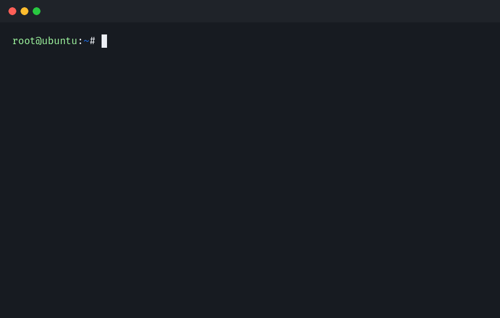

# Routing Rules

Routing rules allow you to control how traffic flows through your proxy chain. You can specify which destinations should be routed directly, through the proxy, or blocked entirely.

## Available Outbounds

### Gateway Server

| Outbound  | Description                   | Use Case               |
| --------- | ----------------------------- | ---------------------- |
| `direct`  | Direct connection to internet | Normal traffic         |
| `blocked` | Block traffic completely      | Ads, malware, tracking |

### Edge Server

| Outbound  | Description                    | Use Case                      |
| --------- | ------------------------------ | ----------------------------- |
| `proxy`   | Route through the SSH tunnel   | Censored content, privacy     |
| `direct`  | Leave from the edge itself     | Streaming, local sites        |
| `blocked` | Block traffic at entry point   | Ads, malware before the chain |
| `dns-out` | Built-in, answers DNS over TCP | Managed automatically         |

> `dns-out` is added by the script and should not be used in custom rules.

## Rule Types

### Domain Rules

Match traffic by domain name or domain patterns.

**Formats:**

- Simple domain: `google.com`, `facebook.com`
- Domain prefix: `domain:netflix.com` (matches subdomains)
- GeoSite: `geosite:cn`, `geosite:google`, `geosite:category-ads`

**Example:**

```bash
./xcp.sh rule add
# Outbound: direct
# Type: 1 (domain)
# Domains: netflix.com,youtube.com,hulu.com
```

### IP Rules

Match traffic by IP address or CIDR range.

**Formats:**

- Individual IP: `8.8.8.8`, `1.1.1.1`
- CIDR range: `192.168.0.0/16`, `10.0.0.0/8`
- GeoIP: `geoip:us`, `geoip:cn`, `geoip:private`, `geoip:ir`

**Example:**

```bash
./xcp.sh rule add
# Outbound: proxy
# Type: 2 (IP)
# IPs: geoip:cn,geoip:ru
```

## Commands

### List Rules

View all custom routing rules.

```bash
./xcp.sh rule ls
```

**Output:**

```
Routing Rules (edge):

1) → proxy
   Domain: twitter.com, facebook.com

2) → direct
   Domain: netflix.com, youtube.com

3) → blocked
   Domain: geosite:category-ads
```

### Add Rule

Add a new routing rule interactively.

```bash
./xcp.sh rule add
```

**Prompts:**

1. Outbound tag (direct/proxy/blocked)
2. Rule type (1=domain, 2=IP)
3. Values (comma-separated)



### Remove Rule

Remove a routing rule by number.

```bash
./xcp.sh rule rm
```

Shows current rules, prompts for rule number to remove.

## Common Use Cases

### Block Advertisements (Gateway)

Block ad and tracking domains at the gateway exit point.

```bash
./xcp.sh rule add
# Outbound: blocked
# Type: domain
# Value: geosite:category-ads,geosite:category-ads-all
```

### Bypass Proxy for Streaming (Edge)

Route streaming services directly for better speed.

```bash
./xcp.sh rule add
# Outbound: direct
# Type: domain
# Value: netflix.com,hulu.com,youtube.com,disney.com
```

### Route Censored Content (Edge)

Ensure specific domains always go through the gateway proxy.

```bash
./xcp.sh rule add
# Outbound: proxy
# Type: domain
# Value: twitter.com,facebook.com,instagram.com
```

### Block Malware Domains (Edge)

Block known malicious domains at the entry point.

```bash
./xcp.sh rule add
# Outbound: blocked
# Type: domain
# Value: malware.example,phishing.bad,tracker.ads
```

### Route Country-Specific Traffic

Route traffic from specific countries through proxy.

```bash
./xcp.sh rule add
# Outbound: proxy
# Type: IP
# Value: geoip:cn,geoip:ir
```

### Local Network Direct Access (Edge)

Bypass proxy for local network traffic.

```bash
./xcp.sh rule add
# Outbound: direct
# Type: IP
# Value: geoip:private,192.168.0.0/16,10.0.0.0/8
```

## Rule Priority

Rules are evaluated in order. First matching rule wins.

### Gateway

1. **Built-in API rule** - Routes Xray API traffic (127.0.0.1:10085)
2. **Built-in DNS rule** - Routes the `dns-in` inbound to `dns-out`
3. **Built-in private IP block** - Blocks private IPs (`geoip:private`)
4. **Custom rules** - Your added rules (evaluated top to bottom)
5. **Default** - Remaining traffic routes to `direct` (first outbound)

### Edge

1. **Built-in API rule** - Routes Xray API traffic (127.0.0.1:10085)
2. **Built-in DNS rule** - Routes the `dns-in` inbound to `dns-out`
3. **Built-in DNS port rule** - Routes UDP/53 to `dns-out` (resolved over TCP through the chain)
4. **Custom rules** - Your added rules (evaluated top to bottom)
5. **Built-in UDP rule** - Blocks remaining UDP (the SSH tunnel is TCP-only)
6. **Built-in client rule** - Routes client traffic (`vless-in`, `ss-in`, `local-in`) to `proxy`

**Important:** Custom rules on Edge are evaluated BEFORE the UDP and client catch-all rules, allowing you to override the default proxy behavior for specific domains/IPs.

> The chain link carries TCP, so send UDP to `direct` when some of it must leave the EDGE.

## GeoIP & GeoSite Data

For GeoIP and GeoSite rules to work, download geo data files during Xray installation:

```bash
# During setup, answer 'Y' when prompted:
Download geo data (geoip.dat, geosite.dat)? [Y/n]: Y
```

**Common GeoSite categories:**

- `geosite:category-ads` - Ad domains
- `geosite:category-ads-all` - All ad-related domains
- `geosite:google` - Google services
- `geosite:netflix` - Netflix domains
- `geosite:cn` - Chinese domains

**Common GeoIP codes:**

- `geoip:private` - Private IP ranges
- `geoip:cn` - China
- `geoip:us` - United States
- `geoip:ir` - Iran
- `geoip:ru` - Russia

## Tips

- **Test carefully** - Rules apply immediately after adding
- **Order matters** - More specific rules should come before general ones
- **Use comma separation** - Add multiple values in one rule for efficiency
- **Check logs** - Use `./xcp.sh logs -f` to see routing in action
- **GeoSite for ads** - Use `geosite:category-ads-all` for comprehensive ad blocking
- **Multiple IPs** - Combine GeoIP with specific IPs/ranges in one rule

## Examples Workflow

### Complete Edge Setup for Censorship Bypass

```bash
# 1. Block ads at entry
./xcp.sh rule add
# blocked, domain, geosite:category-ads-all

# 2. Route streaming direct (faster)
./xcp.sh rule add
# direct, domain, netflix.com,youtube.com,spotify.com

# 3. Route censored sites through proxy
./xcp.sh rule add
# proxy, domain, twitter.com,facebook.com,instagram.com

# 4. View configuration
./xcp.sh rule ls

# 5. Test
./xcp.sh test
./xcp.sh logs -f
```

### Gateway Ad Blocking

```bash
# Block ads and tracking at exit
./xcp.sh rule add
# blocked, domain, geosite:category-ads-all

# Block known malware IPs
./xcp.sh rule add
# blocked, IP, 123.45.67.89,98.76.54.32
```

## FAQ

**Q: How do I edit a rule?**  
A: Replace it — `rule rm` the old one, then `rule add` the new one.

**Q: Can I reorder rules?**  
A: Not directly. Rules apply in the order they were added. To reorder, remove them and add them back in the order you want.

**Q: What is the difference between `domain:` and a plain domain?**  
A: A plain domain (`google.com`) matches that name exactly. `domain:google.com` also matches every subdomain, such as `mail.google.com`.

**Q: How do I tell whether a rule is working?**  
A: Watch the live log with `./xcp.sh logs -f` — traffic matching your rules shows up there.

**Q: How many rules can I add?**  
A: There is no hard limit, but fewer and simpler rules keep matching fast.
