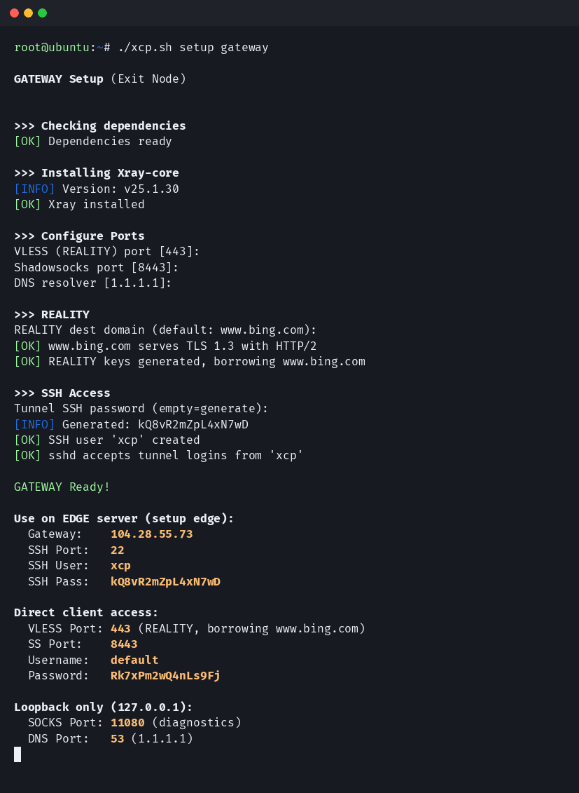
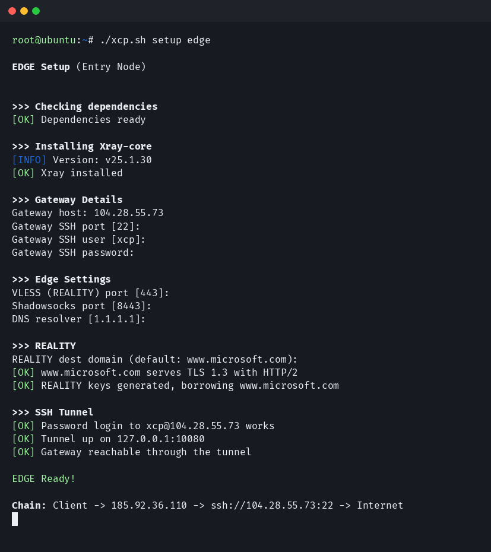
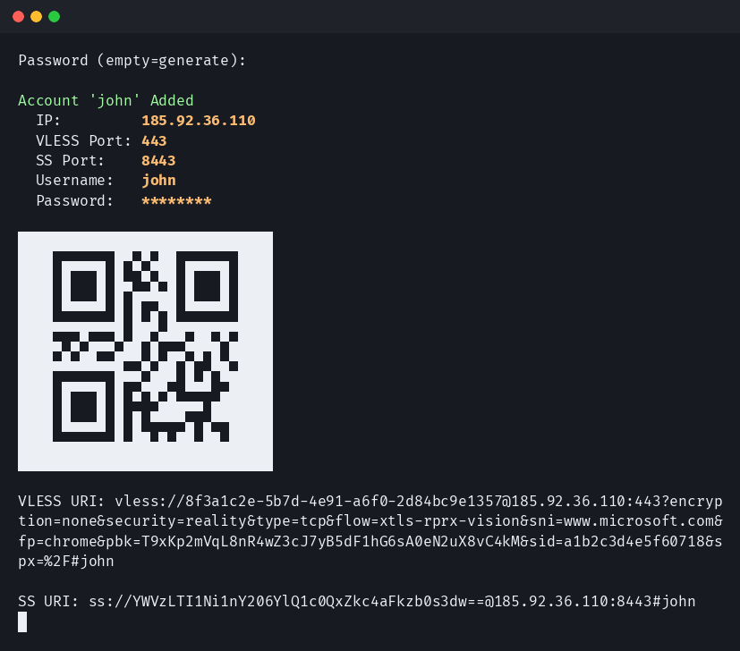
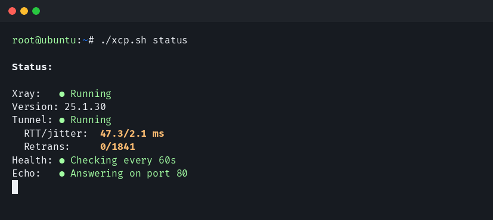
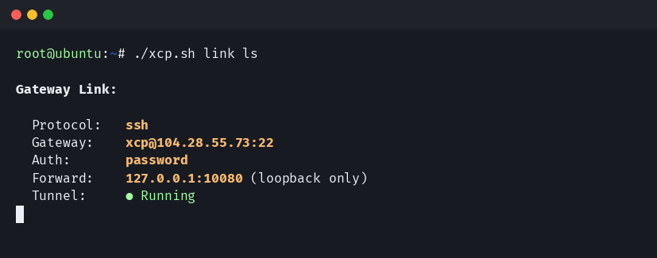
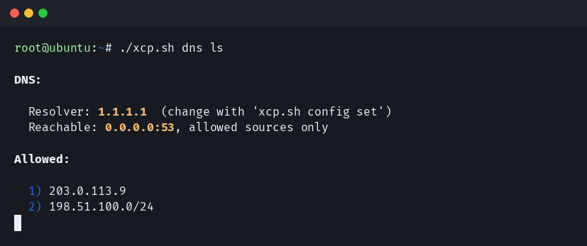
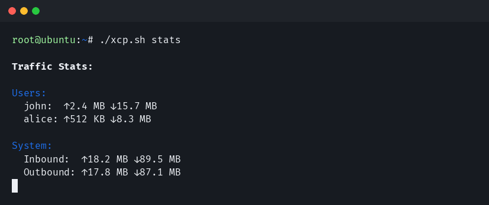
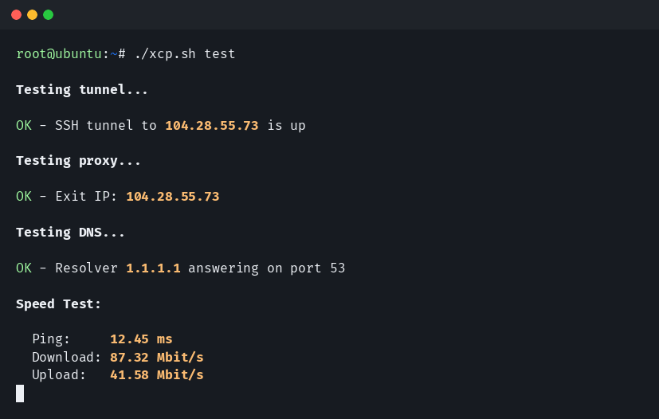
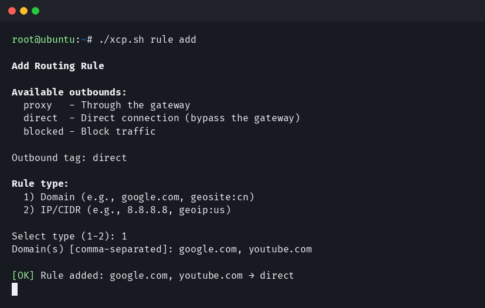

# Showcase

Visual guide to Xray Chain Proxy CLI commands.

## Setup Gateway

Start here. The gateway is your **exit node** — a server with unrestricted internet access. This command installs Xray-core, applies the BBR network tuning, and configures the client ports and DNS resolver.

Next comes REALITY: it asks for a `dest` domain to borrow, checks that the domain really answers with TLS 1.3 and HTTP/2, and generates the keypair. Then it sets up SSH access for the chain — the shell-less `xcp` user with a password (press Enter for a generated 32-character one), allowed in `sshd_config`.

Note the gateway IP, SSH port, user and password — the edge asks for all four, and the password is shown once.

```bash
./xcp.sh setup gateway
```



## Setup Edge

Next, set up the **entry node** — a server close to you in the restricted region. You'll be prompted for the gateway's SSH host, port, user and password from the previous step, then for this server's own ports, resolver and REALITY dest — each edge gets its own keypair.

Setup checks the login, brings up the `xray-tunnel` service, and fetches a page through the tunnel to confirm the gateway's Xray answers on the other side. It also installs the health timer that keeps checking every 60 seconds. Traffic then continues through the gateway's routing rules on its way out.

```bash
./xcp.sh setup edge
```



## Add User

Add a client account to the edge server. Enter a username and optionally a password (leave empty to auto-generate). One account covers both protocols — the password authenticates Shadowsocks and a generated UUID authenticates VLESS.

The output includes the server IP, ports, credentials, a QR code for mobile apps, and both share URIs to copy into a client.

```bash
./xcp.sh user add
```



## Status

Quick health check. Shows whether the Xray service is running, the installed version, and — on an edge server — whether the SSH tunnel to the gateway is up, along with its round-trip time, jitter and retransmit count. A retransmit total that climbs while the link is idle is the earliest sign of a shaped path.

```bash
./xcp.sh status
```



## Gateway Link

Edge-only. Shows where this server chains to: the gateway address, how it authenticates, the loopback port the tunnel forwards, and whether the tunnel is alive. Use `link set` to point the edge at a different gateway — users, ports, DNS and rules carry over — and `link restart` to bounce the tunnel.

```bash
./xcp.sh link ls
```



## DNS Access

The resolver answers on loopback by default, which serves the chain and keeps the server off the open-resolver abuse lists. Devices where DNS is the only setting available — TVs, consoles, routers — can query it once you allow them by address with `dns add`. Adding the first client binds the resolver to `0.0.0.0`; `ufw` enforces the list, and `dns ls` reports whether it is active.

```bash
./xcp.sh dns ls
```



## Traffic Stats

See how much bandwidth each user has consumed, along with total system inbound and outbound traffic. Useful for monitoring usage and identifying heavy users.

```bash
./xcp.sh stats
```



## Test Connection

End-to-end verification. Checks that the SSH tunnel carries traffic to the gateway, proxies a request through this server's own SOCKS5 port to report the exit IP (should match your gateway), resolves a name against the loopback resolver, then measures ping, download and upload.

```bash
./xcp.sh test
```



## Add Routing Rule

Fine-tune how traffic is handled. Choose an outbound (`proxy` sends traffic through the gateway, `direct` leaves from the edge itself, `blocked` drops it), select a rule type (domain or IP/CIDR), and specify the targets. For example, route local domains directly to keep them off the chain, or block unwanted traffic entirely.

```bash
./xcp.sh rule add
```


